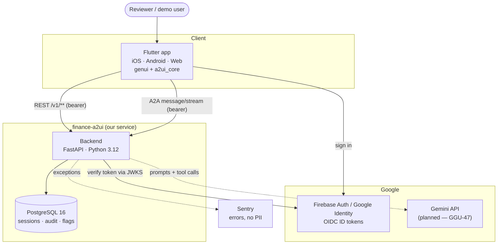

# 01 — System context

Who uses finance-a2ui and what it talks to. Source of truth: [ADR-J](../adr/ADR-J-rest-api-and-a2a-surface.md), [`docs/compliance/CLOUD_SERVICES.md`](../compliance/CLOUD_SERVICES.md). Dashed = planned.

