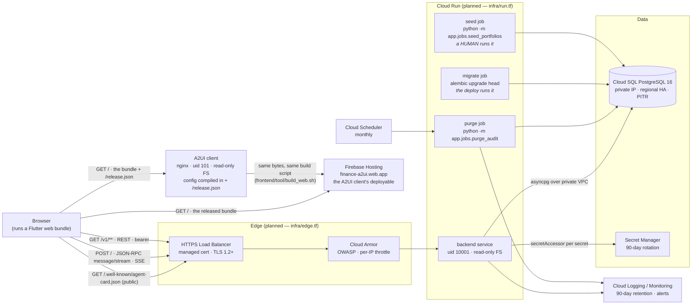

# 02 — Containers and protocols

The deployable pieces. Source of truth: [ADR-F](../adr/ADR-F-persistence-and-session-lifetime.md), [ADR-J](../adr/ADR-J-rest-api-and-a2a-surface.md), [`infra/`](../../infra/README.md). Dashed = planned.

