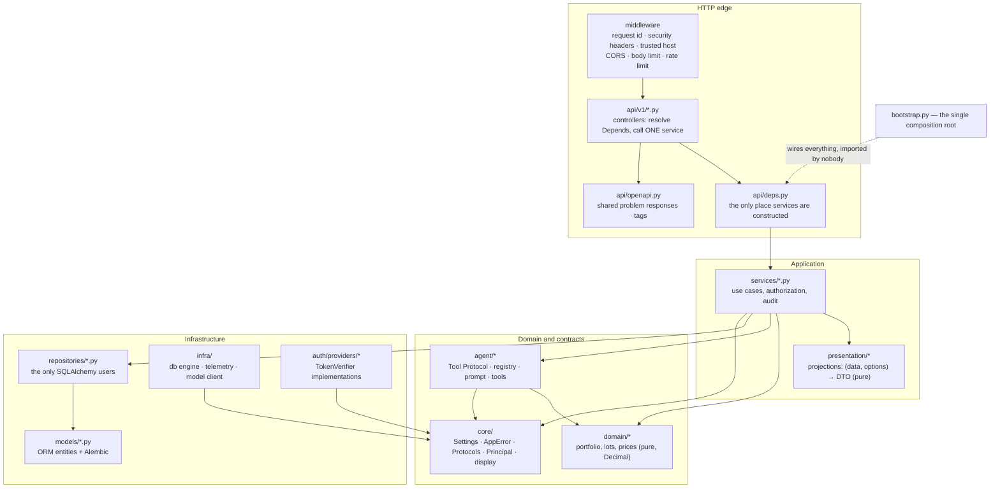

# 03 — Backend layers

Dependencies point inward, always. Source of truth: [`.claude/rules/backend/architecture.md`](../../.claude/rules/backend/architecture.md), [`.claude/rules/backend/presentation.md`](../../.claude/rules/backend/presentation.md).

