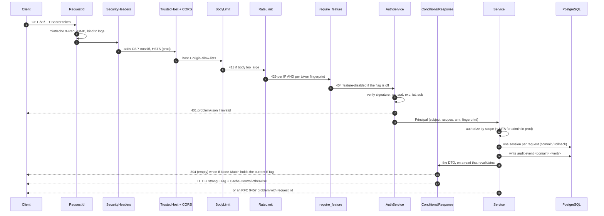

# 04 — Lifecycle of one authenticated request

What every `/v1` call goes through. Source of truth: [`backend/docs/SECURITY.md`](../../backend/docs/SECURITY.md), `api/middleware/install.py::install_middleware`.

