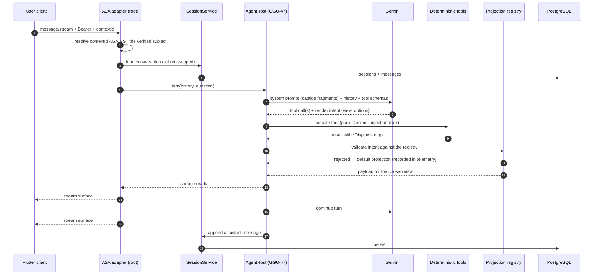

# 05 — An agent turn: question to streamed surfaces

How a sentence becomes UI. Source of truth: [ADR-D](../adr/ADR-D-a2ui-streaming-transport.md), [ADR-K](../adr/ADR-K-response-shaping.md), GGU-47. Dashed = planned.

