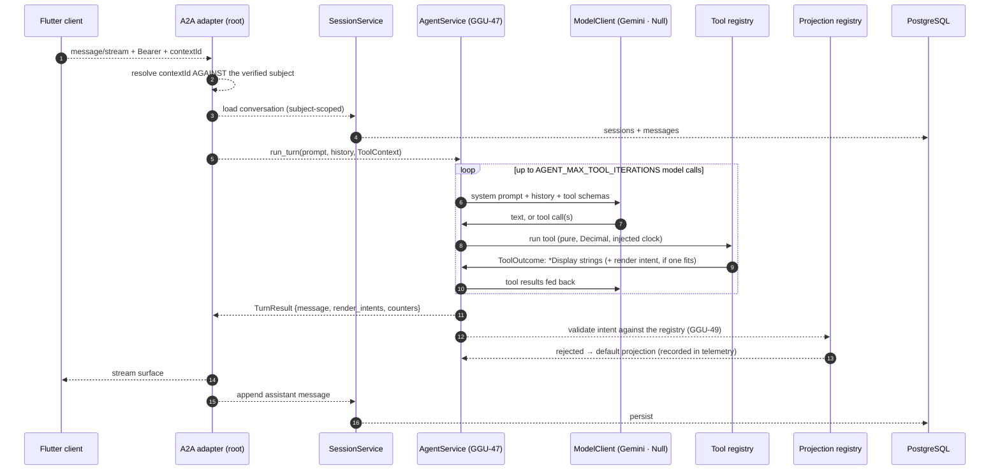

# 05 — An agent turn: question to streamed surfaces

How a sentence becomes UI. Source of truth: [ADR-D](../adr/ADR-D-a2ui-streaming-transport.md), [ADR-K](../adr/ADR-K-response-shaping.md), [spec 0006](../../specs/backend/0006-agent-host.md). Dashed = planned.

`AgentService.run_turn` (GGU-47) is everything between `turn(...)` and the
`TurnResult`. It is deliberately **synchronous and session-free**: it takes the
history as an argument, bounds itself to `AGENT_MAX_TOOL_ITERATIONS` model
calls, and returns the answer plus the render intents it collected. The A2A
adapter (GGU-3) is what turns that into a stream; `SessionService` (GGU-46) is
what supplies and persists the history.

