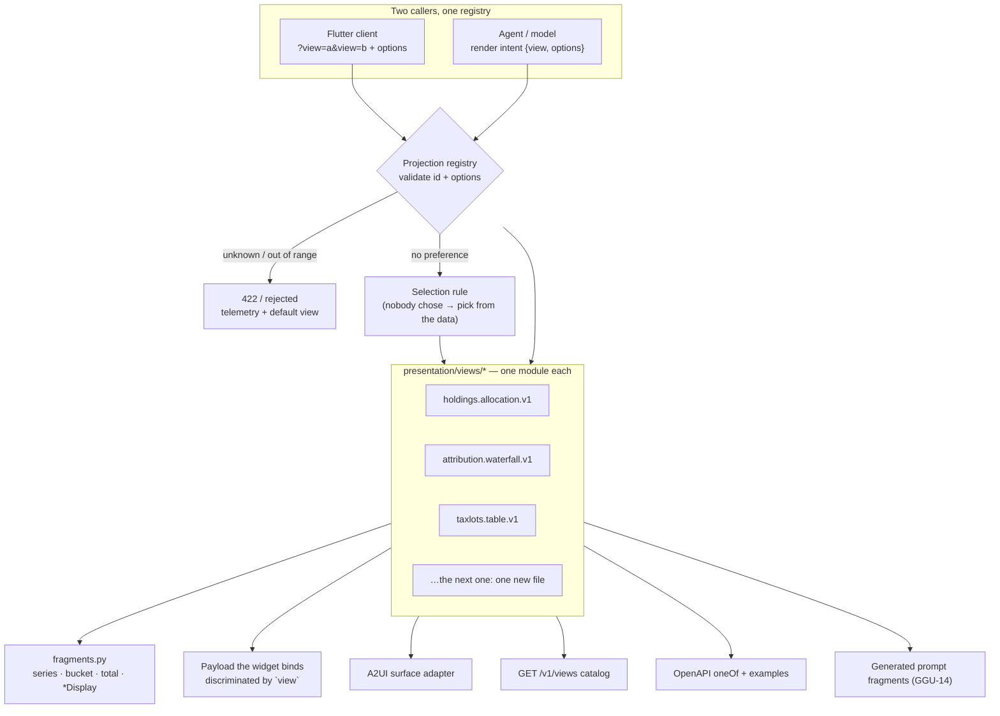

# 06 — Response shaping: who chooses the payload

Source of truth: [ADR-K](../adr/ADR-K-response-shaping.md), [`.claude/rules/backend/presentation.md`](../../.claude/rules/backend/presentation.md).

