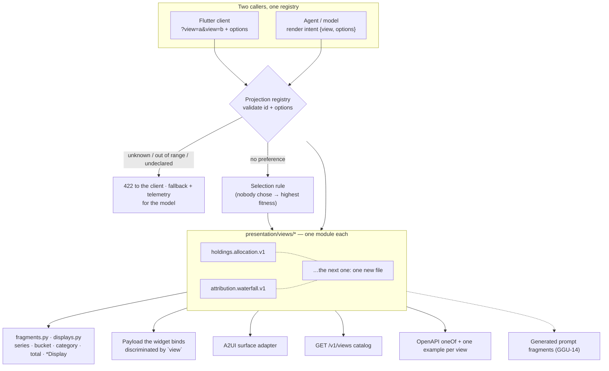

# 06 — Response shaping: who chooses the payload

Source of truth: [ADR-K](../adr/ADR-K-response-shaping.md), [`.claude/rules/backend/presentation.md`](../../.claude/rules/backend/presentation.md), [spec 0005](../../specs/backend/0005-presentation-layer.md).

Solid = built (GGU-49). Dashed = planned, with the ticket that owns it.

## Where each box lives

| Box | Code |
|---|---|
| Registry, Protocol | `backend/src/app/presentation/registry.py`, `spec.py` |
| Options and their bounds | `presentation/options.py` (`extra="forbid"`) |
| Fragments, `*Display` pairs | `presentation/fragments.py`, `displays.py`, `formatting.py` |
| Selection rule | `presentation/selection.py` (ranks each view's own `fitness`) |
| OpenAPI union + examples | `presentation/contract.py` |
| Prompt fragments | `presentation/prompt.py` |
| The two callers | `api/v1/portfolio_views.py` · `services/render_intent_service.py` |
