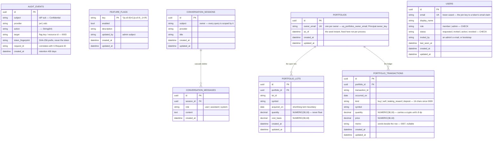

# 07 — Persisted data model

Every table, with the migration that created it. Source of truth: [`backend/alembic/versions/`](../../backend/alembic/versions). Dashed = in review.

| Migration | Adds |
|---|---|
| `0001_audit_events` | the audit trail |
| `0002_feature_flags` | runtime endpoint switches |
| `0003_audit_event_target` | `target`, so `action` stays `<domain>.<verb>` in `String(64)` |
| `0004_sessions` *(GGU-46)* | subject-scoped conversations and their messages |
| `0005_portfolios` *(spec [`backend/0020`](../../specs/backend/0020-portfolio-persistence.md))* | the portfolio, its open tax lots and its transaction ledger |
| `0006_users` *(spec [`backend/0027`](../../specs/backend/0027-user-provisioning.md))* | the provisioning registry — who was invited; no credential, ever |
| `0007_transaction_memo` *(spec [`backend/0028`](../../specs/backend/0028-holdings-and-activity.md))* | `memo` on the ledger, for the words the Activity tab prints beside a row |
| `0008_portfolio_owner_email` *(spec [`backend/0035`](../../specs/backend/0035-the-portfolio-has-an-owner-and-the-tabs-really-filter.md))* | `subject` → `owner_email`; the ownership key becomes the **verified e-mail**, and existing rows are deleted because an opaque `sub` maps to no address |
| `0009_transaction_kind_width` *(spec [`backend/0044`](../../specs/backend/0044-the-portfolio-is-crypto.md))* | `kind` widens to 16 characters for `staking_reward`; the column was sized when `dividend` was exactly eight. No data is migrated — the demo portfolios are **re-seeded**, because a backfill would keep rows whose symbols left the market reference |

**This picture is now checked against both of its sources** (spec
[`backend/0048`](../../specs/backend/0048-the-metadata-knows-every-table.md)).
`tests/integration/test_metadata_completeness.py` compares the metadata
`alembic/env.py` hands to autogenerate against the migrated schema, so a table
in `alembic/versions/` and in no model fails the suite — it used to propose
`op.drop_table()` for `portfolios`, `portfolio_lots`, `portfolio_transactions`
and `users` instead. `updated_at` appears on six tables and is declared once, by
`UpdatedAtMixin` in `models/base.py`; two of the rows above were missing it here
while PostgreSQL had it since `0005`.

**No holdings table, on purpose.** `Portfolio.positions` is derived from the
lots and `Portfolio.validate` proves the derivation on every load; persisting
it would let a holdings row and its lots drift apart with nothing to catch it
(spec `0020` §3).

**No foreign key from `PORTFOLIOS` to `USERS`, on purpose** (spec `0035`
OD-3). Ownership is a value — an e-mail — not a reference: a verified token
whose address is not in the registry never reaches a projection (the access
gate stops it first), and letting the *database* enforce that would couple
seeding to provisioning order and turn a first read into a 500.

The portfolio used to be in process memory, seeded per session — the original
[ADR-F](../adr/ADR-F-persistence-and-session-lifetime.md) D-1/D-2. It moved
here because Cloud Run runs more than one instance: two caches meant one
caller with two `as_of`, and the unique constraint on the ownership key is
what makes two instances seeding a new one converge on a single row. That
constraint was `uq_portfolios_subject` until migration `0008` re-keyed the
table; it is `uq_portfolios_owner_email` now, and the property it buys is
unchanged. ADR-F D-7 carries the current ruling.
