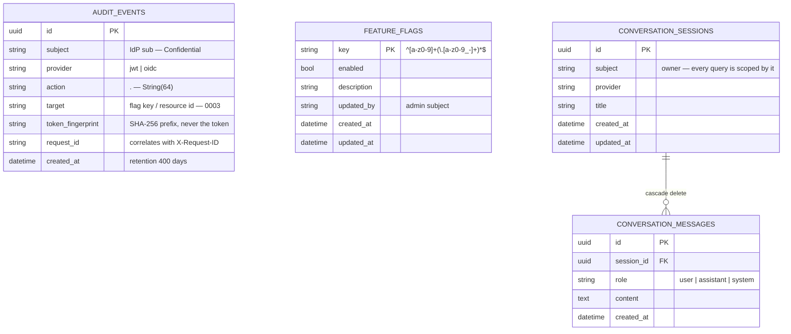

# 07 — Persisted data model

Every table, with the migration that created it. Source of truth: [`backend/alembic/versions/`](../../backend/alembic/versions). Dashed = in review.

| Migration | Adds |
|---|---|
| `0001_audit_events` | the audit trail |
| `0002_feature_flags` | runtime endpoint switches |
| `0003_audit_event_target` | `target`, so `action` stays `<domain>.<verb>` in `String(64)` |
| `0004_sessions` *(in review, GGU-46)* | subject-scoped conversations and their messages |

The portfolio domain (GGU-5) is **in-memory and seeded per session** — it is
deliberately not a table ([ADR-F](../adr/ADR-F-persistence-and-session-lifetime.md)).
