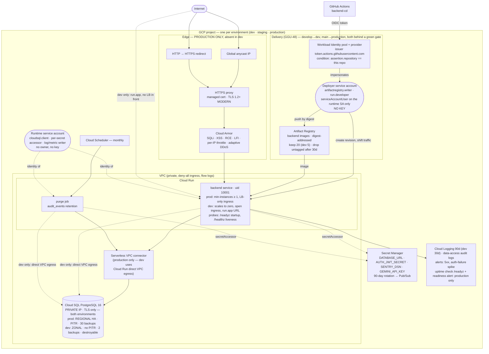

# 08 — Infrastructure (Google Cloud)

What `infra/` creates, and what differs between `dev` and production. **Validated, not applied** — the project is provisioned with GGU-29, dev first. Source of truth: [`infra/README.md`](../../infra/README.md), [`docs/compliance/CLOUD_SERVICES.md`](../compliance/CLOUD_SERVICES.md), [`specs/infra/0001-dev-environment.md`](../../specs/infra/0001-dev-environment.md).

Nodes labelled *production only* are counted out of `dev` by `local.ephemeral` in `main.tf`; dashed edges are the dev-only paths that replace them.

## What dev does not have

| Absent in dev | Still present in dev |
|---|---|
| Cloud Armor WAF, edge rate limit, adaptive DDoS | the application's bearer auth, per-principal rate limiter, error masking, audit events |
| Load balancer, reserved IP, managed certificate, TLS policy | TLS on Cloud Run's own certificate |
| Regional HA, PITR, 30 backups, deletion protection | daily backups (2 retained), synthetic data only |
| Uptime check and readiness alert | 5xx and auth-failure alerts; the deploy's own `/healthz` verify-and-rollback |
| Always-on VPC connector, warm instance | private database IP, TLS-only, `PRIVATE_RANGES_ONLY` egress, deny-all ingress |

Full reasoning and the compliance record: [`specs/infra/0001-dev-environment.md`](../../specs/infra/0001-dev-environment.md) §5, §8.
