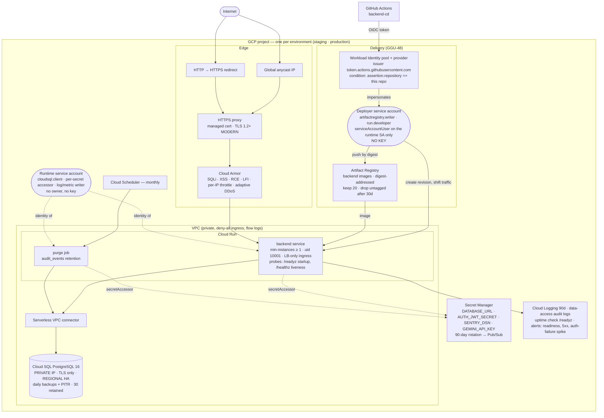

# 08 — Production infrastructure (Google Cloud)

What `infra/` creates. **Validated, not applied** — the projects are created with GGU-29. Source of truth: [`infra/README.md`](../../infra/README.md), [`docs/compliance/CLOUD_SERVICES.md`](../compliance/CLOUD_SERVICES.md).

