# 09 — Where each check runs

Cheap checks locally, expensive ones once, and nothing released without the gate. Source of truth: [`.claude/rules/ci-conventions.md`](../../.claude/rules/ci-conventions.md), `.github/workflows/`, [`specs/infra/0001-dev-environment.md`](../../specs/infra/0001-dev-environment.md). Dashed = the environments do not exist yet (GGU-29 applies Terraform); the pipeline itself is merged.

```mermaid
flowchart LR
    subgraph dev["Developer machine — free"]
        edit["edit"]
        pc["pre-commit<br/>hygiene · gitleaks · ruff · codespell<br/>actionlint · shellcheck · terraform fmt<br/>basedpyright · 150-line budget · quality suite<br/>unit tests · delivery script tests"]
        pp["pre-push<br/>make gate (full, with PostgreSQL)"]
    end
    subgraph ci["GitHub Actions — paid, only what a laptop cannot prove"]
        q["Quality · style, types, complexity, duplication"]
        t["Tests · pytest 100% branch on PostgreSQL 16 service container"]
        s["Security · gitleaks full history · Semgrep · pip-audit"]
        img["Container · build · non-root · Trivy CVE"]
        rep["Report · ship-gate summary"]
    end
    subgraph cd["backend-cd — after merge"]
        gate["Gate · backend-ci called as a job<br/>publish and deploy need: it"]
        pub["Image · build, push by digest to Artifact Registry"]
        dep["Deploy · revision with no traffic → /readyz → shift 100%"]
        ver["Verify · /health reports the released identifier"]
        rb["Rollback · traffic back to the previous revision, run fails"]
    end
    subgraph sched["Scheduled"]
        wk["Weekly scan<br/>pip-audit + SBOM · Trivy SARIF · gitleaks"]
    end

    edit --> pc --> pp --> pr["Pull request → develop"]
    pr --> q & t & s
    q --> img
    t --> img
    q & t & s & img --> rep
    rep --> merge["Squash merge<br/>1 code-owner approval"]
    merge --> gate --> pub --> dep --> ver
    ver -- "not healthy" --> rb
    dep -. "develop" .-> dv["Cloud Run dev<br/>(no human step)<br/>probed at its run.app URL"]
    dep -. "main, after environment approval" .-> prd["Cloud Run production<br/>probed at the LB domain"]
    merge --> wk

    %% The `gate` node is backend-ci.yaml called via workflow_call, in the SAME
    %% run as the deploy, so `needs:` makes the ordering an Actions guarantee —
    %% not a workflow_run trigger that fires on completion whatever the result.
    %% backend-ci therefore has no push trigger of its own: it would run twice.
    %% There is no staging box: dev replaced it as develop's target.
    %% Authentication is Workload Identity Federation: no service-account key
    %% exists in repository secrets, and a test fails the build if one appears.
    %% Traffic never lands on an unverified revision — that ordering is the
    %% whole point of deploying with --no-traffic first.
```

**Why the deploy is a script, not inline YAML.** `infra/scripts/deploy_cloud_run.sh`
holds the deploy-verify-rollback sequence so it can be run against a stub
`gcloud` and tested (`infra/scripts/tests/test_deploy_cloud_run.sh`). A rollback
path that has never executed is not a rollback path. See
[spec 0007](../../specs/backend/0007-cd-pipeline.md).

**Why the gate is a called workflow, not a trigger.** `backend-cd` runs
`backend-ci.yaml` as its `ci` job and every later job declares `needs: [ci, …]`.
A red quality, test, security or image job leaves `publish` and `deploy`
*skipped*, and the `report` job counts `skipped` as failure — so a run that
released nothing is never reported green. The alternative, a `workflow_run`
trigger, fires when CI *completes* regardless of conclusion and relies on
remembering to inspect it. `infra/scripts/tests/test_dev_environment.sh`
asserts the `needs` edges, so removing one fails the build.
