# 09 — Where each check runs

Cheap checks locally, expensive ones once, and nothing released without the gate. Source of truth: [`.claude/rules/ci-conventions.md`](../../.claude/rules/ci-conventions.md), `.github/workflows/`, [`specs/infra/0001-dev-environment.md`](../../specs/infra/0001-dev-environment.md). Dashed = the environments do not exist yet (GGU-29 applies Terraform); the pipeline itself is merged.

```mermaid
flowchart LR
    subgraph dev["Developer machine — free"]
        edit["edit"]
        pc["pre-commit<br/>hygiene · gitleaks · ruff · codespell<br/>actionlint · shell lint (all tracked) · gate pairs<br/>manual-run check · frontend toolchain preflight<br/>terraform fmt · basedpyright · 150-line budget<br/>quality suite · unit tests · delivery script tests"]
        pp["pre-push<br/>make gate (full, with PostgreSQL)"]
    end
    subgraph ci["GitHub Actions — paid, only what a laptop cannot prove"]
        %% repo-ci carries NO paths: filter. Everything else here is scoped to
        %% one stack, which is why secret and shell scanning cannot live there:
        %% a client-only pull request would start none of it.
        r["Repository · spelling · secrets (full history) · shell lint · gate pairs<br/>manual-run check (GGU-93)<br/>every PR, no paths: filter"]
        q["Quality · style, types, complexity, duplication"]
        t["Tests · pytest 100% branch on PostgreSQL 16 service container"]
        s["Security · Semgrep · pip-audit<br/>backend/** only"]
        img["Container · build · non-root · Trivy CVE"]
        rep["Report · ship-gate summary"]
    end
    subgraph cd["backend-cd — the button only"]
        gate["Gate · backend-ci AND repo-ci called as jobs<br/>publish and deploy need: both"]
        pub["Image · build, push by digest to Artifact Registry"]
        dep["Deploy · revision with no traffic → /readyz<br/>→ pin EVERY Cloud Run job to the digest → migrate → shift 100%"]
        ver["Verify · /health reports the released identifier"]
        rb["Rollback · traffic back to the previous revision, run fails"]
    end
    subgraph sched["Scheduled"]
        wk["Weekly scan<br/>pip-audit + SBOM · Trivy SARIF · gitleaks"]
    end

    edit --> pc --> pp --> pr["Pull request → develop"]
    pr --> r & q & t & s
    q --> img
    t --> img
    r & q & t & s & img --> rep
    rep --> merge["Squash merge<br/>1 code-owner approval"]
    merge -. "nothing runs on a merge" .-> btn["Run workflow (a human presses it)"]
    btn --> gate --> pub --> dep --> ver
    ver -- "not healthy" --> rb
    dep -. "run from develop" .-> dv["Cloud Run dev<br/>(started by hand)<br/>probed at its run.app URL"]
    dep -. "main, after environment approval" .-> prd["Cloud Run production<br/>probed at the LB domain"]
    merge --> wk

    %% The `gate` node is backend-ci.yaml AND repo-ci.yaml, both called via
    %% workflow_call in the SAME run as the deploy, so `needs:` makes the
    %% ordering an Actions guarantee — not a workflow_run trigger that fires on
    %% completion whatever the result.
    %% backend-ci therefore has no push trigger of its own: it would run twice.
    %% repo-ci is called too because secret scanning lives there now; without
    %% that edge, moving gitleaks out of backend-ci would have silently taken it
    %% off the path to production.
    %% Nothing is deployed by a merge: backend-cd is workflow_dispatch only.
    %% There is no staging box: dev replaced it as develop's target.
    %% Authentication is Workload Identity Federation: no service-account key
    %% exists in repository secrets, and a test fails the build if one appears.
    %% Traffic never lands on an unverified revision — that ordering is the
    %% whole point of deploying with --no-traffic first.
```

**What this diagram does not draw.** `q`, `t`, `s` and `img` are `backend-ci`.
`frontend-ci` runs beside them on a `frontend/**` pull request — quality, tests
and a release web build — and `repo-ci` on every pull request whatever it
touches; neither is drawn here. Said rather than left implied: a reader should
not take this as the whole set of pipelines.

> This paragraph has been wrong about `client-ci` twice, in both directions. It
> said *"`client-ci` does not exist at all"*, which was true when written and
> false by the time anyone read it — GGU-1 (PRs #26 and #30) wrote that
> workflow. It then named it as a live pipeline until 2026-09-22, when
> `client_flutter/` was retired and the workflow deleted (spec `repo/0002`). A
> sentence asserting the presence **or** the absence of a file is a claim with
> a truth value, and it has to be re-read whenever that file's directory
> changes. `.claude/rules/ci-conventions.md` §4b keeps the same table honest
> and records the same lesson, having been walked back twice itself.

**The `cd` box is the backend's.** The A2UI client has one too — `frontend-cd`,
a button, gate-first, publishing to Firebase Hosting — and it is drawn on its
own in [13 — How the A2UI client reaches a browser](13-client-delivery.md),
because it answers a different question and this diagram is already at its node
budget. `infra/scripts/tests/test_dev_environment.sh` asserts both pipelines'
`needs:` edges, so neither can lose its gate quietly.

**Why the frontend gate opens with a toolchain preflight.** `frontend.toolchain`
(`frontend/tool/check_toolchain.sh`) runs first, locally and on the runner,
because every check after it is read through `dart` and `flutter`. A Dart below
the SDK floor declared in `frontend/pubspec.yaml` used to announce itself as a
formatting diff, which reads as a red branch and is a red toolchain (GGU-94).
The version it enforces lives only in `frontend/.fvmrc`.

**Why the deploy is a script, not inline YAML.** `infra/scripts/deploy_cloud_run.sh`
holds the deploy-verify-rollback sequence so it can be run against a stub
`gcloud` and tested (`infra/scripts/tests/test_deploy_cloud_run.sh`). A rollback
path that has never executed is not a rollback path. See
[spec 0007](../../specs/backend/0007-cd-pipeline.md).

**Why the gate is a called workflow, not a trigger.** `backend-cd` runs
`backend-ci.yaml` as its `ci` job and every later job declares `needs: [ci, …]`.
A red quality, test, security or image job leaves `publish` and `deploy`
*skipped*, and the `report` job counts `skipped` as failure — so a run that
released nothing is never reported green. The alternative, a `workflow_run`
trigger, fires when CI *completes* regardless of conclusion and relies on
remembering to inspect it. `infra/scripts/tests/test_dev_environment.sh`
asserts the `needs` edges, so removing one fails the build.
