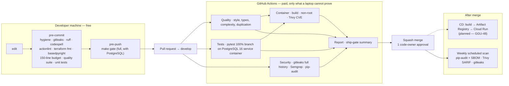

# 09 — Where each check runs

Cheap checks locally, expensive ones once. Source of truth: [`.claude/rules/ci-conventions.md`](../../.claude/rules/ci-conventions.md), `.github/workflows/`. Dashed = planned (GGU-48).

