# 09 — Where each check runs

Cheap checks locally, expensive ones once. Source of truth: [`.claude/rules/ci-conventions.md`](../../.claude/rules/ci-conventions.md), `.github/workflows/`. Dashed = the environments do not exist yet (GGU-29 applies Terraform); the pipeline itself is merged.

```mermaid
flowchart LR
    subgraph dev["Developer machine — free"]
        edit["edit"]
        pc["pre-commit<br/>hygiene · gitleaks · ruff · codespell<br/>actionlint · shellcheck · terraform fmt<br/>basedpyright · 150-line budget · quality suite<br/>unit tests · delivery script tests"]
        pp["pre-push<br/>make gate (full, with PostgreSQL)"]
    end
    subgraph ci["GitHub Actions — paid, only what a laptop cannot prove"]
        q["Quality · style, types, complexity, duplication"]
        t["Tests · pytest 100% branch on PostgreSQL 16 service container"]
        s["Security · gitleaks full history · Semgrep · pip-audit"]
        img["Container · build · non-root · Trivy CVE"]
        rep["Report · ship-gate summary"]
    end
    subgraph cd["backend-cd — after merge"]
        pub["Image · build, push by digest to Artifact Registry"]
        dep["Deploy · revision with no traffic → /readyz → shift 100%"]
        ver["Verify · /healthz reports the released identifier"]
        rb["Rollback · traffic back to the previous revision, run fails"]
    end
    subgraph sched["Scheduled"]
        wk["Weekly scan<br/>pip-audit + SBOM · Trivy SARIF · gitleaks"]
    end

    edit --> pc --> pp --> pr["Pull request → develop"]
    pr --> q & t & s
    q --> img
    t --> img
    q & t & s & img --> rep
    rep --> merge["Squash merge<br/>1 code-owner approval"]
    merge --> pub --> dep --> ver
    ver -- "not healthy" --> rb
    dep -. "develop" .-> stg["Cloud Run staging<br/>(no human step)"]
    dep -. "main, after environment approval" .-> prd["Cloud Run production"]
    merge --> wk

    %% Authentication is Workload Identity Federation: no service-account key
    %% exists in repository secrets, and a test fails the build if one appears.
    %% Traffic never lands on an unverified revision — that ordering is the
    %% whole point of deploying with --no-traffic first.
```

**Why the deploy is a script, not inline YAML.** `infra/scripts/deploy_cloud_run.sh`
holds the deploy-verify-rollback sequence so it can be run against a stub
`gcloud` and tested (`infra/scripts/tests/test_deploy_cloud_run.sh`). A rollback
path that has never executed is not a rollback path. See
[spec 0007](../../specs/backend/0007-cd-pipeline.md).
