# 10 — From a ticket to production

Source of truth: [`docs/compliance/CHANGE_MANAGEMENT.md`](../compliance/CHANGE_MANAGEMENT.md), [`.claude/rules/backend/sdd.md`](../../.claude/rules/backend/sdd.md).

```mermaid
flowchart LR
    t["Jira ticket<br/>To Do"] --> sp["Spec written<br/>specs/backend/NNNN-*.md"]
    sp --> ap{"Human approves<br/>the spec"}
    ap --> ip["Ticket → In Progress<br/>branch type/GGU-n_* from develop"]
    ip --> code["Implement by layer<br/>migration → model → schema → repository<br/>→ service → projection → controller → deps → router"]
    code --> gate["make gate green<br/>+ backend-reviewer agent"]
    gate --> prd["PR → develop<br/>title carries GGU-n · body: description,<br/>test output AND a real manual run"]
    prd --> rev["Ticket → In Review"]
    rev --> ok{"1 code-owner<br/>approval + checks"}
    ok --> mg["Squash merge to develop"]
    mg --> dn["Ticket → Done"]
    mg --> rel["Release PR develop → main<br/>tag vX.Y.Z · CHANGELOG"]
    rel --> prod["Production"]

    %% main is release-only. Hotfixes branch from main and are merged back
    %% into develop the same day. The repository allows squash merges only.
```

