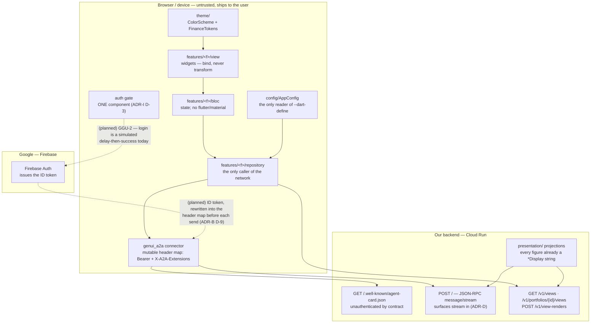

# 11 — Client architecture

What the Flutter client is made of, and what each layer is allowed to reach. Source of truth: [`.claude/rules/client/architecture.md`](../../.claude/rules/client/architecture.md), [`.claude/rules/client/presentation.md`](../../.claude/rules/client/presentation.md), [ADR-I](../adr/ADR-I-client-routing.md), [ADR-K](../adr/ADR-K-response-shaping.md).

**Legend.** Solid = built and exercised today. Dashed + `(planned)` = not built:
Firebase auth is GGU-2, and the current `LoginBloc` simulates success.

**Two error shapes cross the `svc` boundary** and a repository must parse both
(ADR-J D-3): `/v1/**` answers RFC 9457 `application/problem+json`, while the
A2A root answers JSON-RPC **error objects with HTTP 200**. A failure before the
A2A envelope is parsed is a problem document on the A2A surface, so HTTP 200 is
not success there.

**The 220-line file budget and the layer directions above are review rules, not
checks.** The client gate (`dart.format`, `dart.analyze`, `client.tokens`,
`client.config`, `flutter.test`, `flutter.web`) lands with GGU-1 and enforces
formatting, analysis and the theme/config boundaries — not this diagram.
