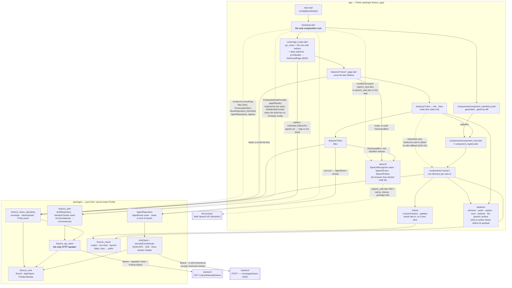

# 12 — Frontend layers

**Question:** in the `frontend/` client, what may import what, and where does a
payload go between the socket and the screen?
**Source of truth:** [ADR-L](../adr/ADR-L-client-architecture.md),
`.claude/rules/frontend/architecture.md`, and
`frontend/app/test/architecture/layering_test.dart` — which is what keeps this
picture true rather than aspirational.

## Reading it

- **Dependencies point one way**: `view → bloc → repository → api client → core`. Nothing skips a layer and nothing points back up.
- **`page → repo`** is real and deliberate: a page builds its bloc, so it reads the repository the bloc takes. That is the page/view split from `.claude/rules/flutter/architecture.md`, and `layering_test.dart::only a page resolves a repository from the widget tree` allows it in `*_page.dart` **and nowhere else**. The `_View` below it reads bloc state only.
- **`comp → repo`** looks like the same shortcut and is not: a component imports `ViewPayload` — a *type* — and never a repository instance.
- **`boot -.-> repo`** is dashed because it is construction, not a call. `bootstrap.dart` is the only file allowed to draw it; `layering_test.dart` fails if any other does.
- **A chart is split across the boundary, on purpose.** `finance_charts` is the geometry — scales, readable tick steps, *(steps, size) → rectangles* — and it is pure Dart, so it runs under `dart test` and its output is asserted arithmetically. The `CustomPainter` that turns those rectangles into pixels needs `dart:ui`, which `packages/` may not have, so it sits in `app/lib/charts/` (ADR-L D-13). The split is not a compromise: it is what makes "the chart is in the right place" a claim a test can check.
- **`comp → geom` carries a raw number, and only that one.** A bar's position comes from the contract's raw `amount`, read through `ViewPayload.geometry` — the single path-scoped exemption to the numbers rule (ADR-L D-14). Every *figure on screen* is still a `*.display` string; the raw value never reaches a `Text`.
- **The generated manifest is the seam.** Adding a component adds a directory and regenerates `component_manifest.g.dart`; no hand-written file in this diagram changes (ADR-L D-3, mirroring ADR-K D-15).
- **The agent path rejoins the read path on purpose.** A `render-intent` names a registered view and carries no payload, so `ConversationBloc` fetches it through the *same* `ViewsRepository` and renders it through the *same* `ComponentHost` and registry as a `?view=` read. The two routes into `comp` are two callers of one seam, **not** two rendering paths — a second path is what ADR-K D-15 and ADR-L D-3 exist to prevent, and it is the defect class this repository has hit three times on the backend side.
- **One view bypasses `ComponentHost`, and the dashed edge says so.** `ViewComponent.build(context, payload)` has no slot for a callback, so a surface that must send something back cannot go through the host. `OrderTicketView` therefore builds `OrderTicketCard` itself and attaches `onOptionChanged` (GGU-61, spec `frontend/0006` OD-4) — the same shape `AttributionWaterfallCard.onSegmentTap` already has, with a host that actually uses it. Two things keep this from becoming the second rendering path the bullet above warns about: the **binding** still comes from `OrderTicketComponent.read`, so the component remains the single owner of that payload's shape, and the view repeats the host's contract handling — a `PayloadContractException` is caught and *shown*, naming the path, never thrown into a red screen. It is a second **caller**, not a second binding. If a third such surface appears, the callback belongs on the seam instead, and that is an ADR-L amendment rather than a third copy.
- **Two backend nodes, two protocols, one credential.** `/v1/**` is REST with RFC 9457 problems; `POST /` is JSON-RPC that answers SSE and reports some failures at **HTTP 200** (ADR-J D-3). They share one `http.Client` and one token provider, which is why `A2aClient` sits beside `FinanceApiClient` rather than inside it.
- **Unknown locations are the app's, not go_router's.** `errorBuilder` draws `NotFoundPage` (under `features/shell`, outside the shell's tab bar) and `AppRoutes.aliases` redirects the guessable synonyms as routes, so the auth redirect still runs first (spec frontend/0025 OD-6).
- **The router names no view id.** It used to carry a hardcoded one, so a registered component could be unreachable with a green gate; `PortfolioViewsPage` now asks the registry (GGU-79).
- **The browser is a dependency, so it is behind a seam like any other.** Dictation (spec [frontend/0023](../../specs/frontend/0023-voice-input.md)) needs `SpeechRecognition`, which exists only on the web and only in some browsers. `app/lib/speech/` is the interface, the event union and the failure enum; `speech_web.dart` is the only file that imports `dart:js_interop` or `package:web`, and `bootstrap.dart` is the only file that names either implementation — through a conditional import, which is why the edge from `boot` is dashed like every other construction edge. Two consequences the picture is drawn to make obvious: `VoiceInputBloc` is driven by a fake in every test, and `speech_web.dart` is the one file `flutter test` cannot load, which is why it is a coverage exemption and why nothing that can be decided lives in it.
- **Nothing is deployed.** There is no pipeline shipping this bundle yet — `specs/client/0002-client-delivery.md` owns that — so no edge crosses into Google Cloud here. See [02-containers](02-containers.md) for where it will attach.
