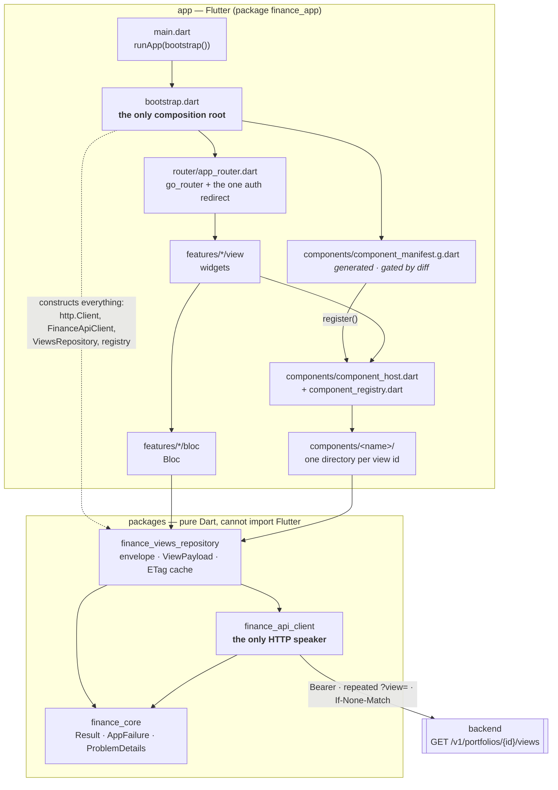

# 12 — Frontend layers

**Question:** in the `frontend/` client, what may import what, and where does a
payload go between the socket and the screen?
**Source of truth:** [ADR-L](../adr/ADR-L-client-architecture.md),
`.claude/rules/frontend/architecture.md`, and
`frontend/app/test/architecture/layering_test.dart` — which is what keeps this
picture true rather than aspirational.

## Reading it

- **Dependencies point one way**: `view → bloc → repository → api client → core`. Nothing skips a layer and nothing points back up.
- **`comp → repo`** is the one edge that looks like a shortcut and is not: a component imports `ViewPayload` — a *type*, from the repository layer — and never a repository instance. It has no `bloc` and no transport.
- **`boot -.-> repo`** is dashed because it is construction, not a call. `bootstrap.dart` is the only file allowed to draw it; `layering_test.dart` fails if any other does.
- **The generated manifest is the seam.** Adding a component adds a directory and regenerates `component_manifest.g.dart`; no hand-written file in this diagram changes (ADR-L D-3, mirroring ADR-K D-15).
- **Nothing is deployed.** There is no pipeline shipping this bundle yet — `specs/client/0002-client-delivery.md` owns that — so no edge crosses into Google Cloud here. See [02-containers](02-containers.md) for where it will attach.
