# 13 — How the A2UI client reaches a browser

One bundle, built once, proven at a URL before anyone is sent to it. Source of truth: [`specs/frontend/0017`](../../specs/frontend/0017-the-client-runs-in-the-stack-and-ships-itself.md), [`.github/workflows/frontend-cd.yaml`](../../.github/workflows/frontend-cd.yaml), [`frontend/tool/build_web.sh`](../../frontend/tool/build_web.sh). Diagram [09](09-delivery-pipeline.md) answers *where each check runs*; this one answers only *how the client ships*.

```mermaid
flowchart LR
    btn["Run workflow<br/>(a human presses it)"]
    gate["Gate · frontend-ci AND repo-ci<br/>called as jobs · publish and deploy need: both"]
    build["Bundle · tool/build_web.sh<br/>one environment's config compiled in<br/>+ /release.json"]
    art["Artifact · the exact bytes"]
    prev["Preview channel<br/>a full deploy nobody is sent to"]
    v1{"/release.json<br/>== this commit?"}
    live["Live channel<br/>finance-a2ui.web.app"]
    v2{"/release.json<br/>== this commit?"}
    red["Run fails, loudly<br/>rollback is Hosting's release history"]
    ok["Released"]

    dock["frontend/Dockerfile<br/>local stack, :3001"]

    btn --> gate --> build --> art --> prev --> v1
    v1 -- no --> red
    v1 -- yes --> live --> v2
    v2 -- no --> red
    v2 -- yes --> ok
    build -. "same script, same flags" .-> dock

    %% Why a preview channel: Hosting has no traffic split, so this is the
    %% nearest thing to backend-cd's --no-traffic revision — the same bytes at
    %% an address no user is sent to. Losing it would leave "the deploy step
    %% exited 0" as the only evidence.
    %% Why TWO checks of the same file: the first proves the bundle works at a
    %% real URL, the second proves the LIVE origin is serving it. They are
    %% different claims and they have disagreed before, on the backend (GGU-93).
    %% Why /release.json at all: a static bundle has no /health to ask. The
    %% build writes the answer beside it; both the container and firebase.json
    %% serve it no-store.
    %% The dashed edge is a "built by" relation, not a call: the container is
    %% the local stack's copy of the same bytes, never the deployable.
    %% Nothing here runs on a merge, and no service-account key exists: the
    %% deployer is reached through Workload Identity Federation, the same
    %% identity backend-cd uses, plus roles/firebasehosting.admin.
```

**What this diagram does not draw.** The gate itself — that is `frontend-ci`,
drawn as part of [09](09-delivery-pipeline.md). Nor the older
`client_flutter/` app, which has a CI pipeline (`client-ci`) and **no** CD:
where it is hosted is still open (spec `client/0002` OD-1).
