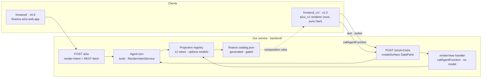

# 14 — How an agent turn reaches the v1.0 client

The v1.0 path runs beside v0.9 and shares only what sits behind the turn. Source of truth: [ADR-M](../adr/ADR-M-a2ui-v1-wire.md), [`backend/0053`](../../specs/backend/0053-the-agent-speaks-a2ui-v1.md), [`frontend_v1/0001`](../../specs/frontend_v1/0001-a-second-client-renders-a2ui-v1.md), the wire examples in [`docs/a2ui/v1.0/examples/`](../a2ui/v1.0/examples/). Diagram [05](05-agent-turn.md) draws the turn itself; this one draws only what differs after it.

**Not drawn:** the REST read endpoints, which both clients may call and which
did not change; the v1.0 Hosting site, which needs a site created by a human
(ADR-M OD-1) before it is drawn as deployed.
