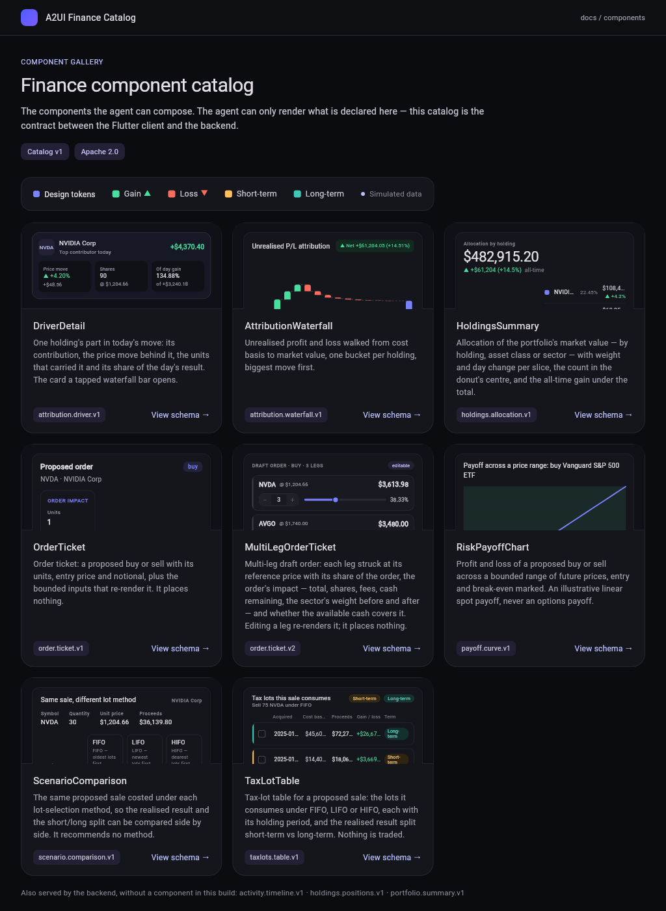

# Guides

Task-shaped documentation: how to *use* what the ADRs decided. Each guide names
its source of truth in its first lines and re-argues none of it — if a guide and
an ADR disagree, the ADR is right and the guide is a bug.

| Guide | Answers |
|---|---|
| [`feeding-charts.md`](feeding-charts.md) | How a client or the agent gets chart data: `GET /v1/portfolios/current/views`, `POST /v1/view-renders`, the `GET /v1/views` catalog, ETags and 304s, the ADR-E display/raw pair, the numbers rule, and the A2A render-intent stream |
| [`schema-mutations.md`](schema-mutations.md) | How a shape is allowed to change: versioned ids (`order.ticket.v1` and `v2` side by side), declared bounded options, what makes a field editable, render-intent validation with its fallback and metric, surface actions, the generated artefacts and their digests, and the checklist for adding a chart |

Both are written against a running stack: every `curl` in them was executed and
every response pasted back as it came, on 2026-09-22 against
`local+b7e78bf`.

## The screenshots

`assets/` holds two kinds of image, and the difference matters when you are
checking a claim:

| Kind | Files | What it proves |
|---|---|---|
| **Captures of the running client** | `home_phone`, `holdings_phone`, `activity_phone`, `ask_phone_waterfall`, `ask_phone_taxlots`, `ask_phone_ticket`, `order_ticket_v2_phone`, `catalog_index`, `catalog_index_dark`, `catalog_waterfall_light`, `catalog_waterfall_dark`, `catalog_order_ticket_v2_light`, `catalog_payoff_light` | that the payload really does drive the pixels — the figures on screen are the `display` strings in the guide's captured JSON |
| **Charts drawn from a captured payload** | `waterfall_from_payload`, `payoff_from_payload` | that the raw/display split is sufficient: the marks are placed from `amount`/`value`, every label is a copied `display` string |



## The PDF

[`feeding-charts-and-schema-mutations.pdf`](feeding-charts-and-schema-mutations.pdf)
is both guides in one printable file, with the Mermaid diagrams rasterised and
the screenshots embedded. Rebuild it from the repository root:

```bash
bash docs/guides/tool/build_pdf.sh
```

It needs `python3`, Google Chrome (set `CHROME=<path>` for another Chromium)
and, the first time, network access for the pinned Mermaid CDN script. It adds
no dependency to the repository: the Markdown converter in
[`tool/md_to_html.py`](tool/md_to_html.py) implements exactly the subset these
two files use, and Chrome does the printing.

**The Markdown is the source of truth; the PDF is a generated export.** Edit
the `.md`, re-run the script, commit both. Never edit the PDF.

### Why a binary is committed here

[`.claude/rules/diagrams.md`](../../.claude/rules/diagrams.md) says diagrams are
Mermaid inside Markdown and that *"screenshots and binary exports are not
accepted: they drift silently and cannot be reviewed."* That rule stands, and
this file is a **deliberate, documented exception to it**, for one reason: a
shareable PDF was explicitly asked for, and neither `.md` nor a GitHub link is
shareable with someone who does not have the repository.

The exception is narrow, and it keeps the property the rule protects:

- **Nothing is authored in the PDF.** Every diagram in it is still Mermaid in a
  `.md` file, reviewed as text in a pull request.
- **It is reproducible.** One command regenerates it from the same sources.
- **It is derived, so it cannot be the thing that drifts silently** — it can
  only be *stale*, and a stale export is visible the moment anyone regenerates
  it.

This is the weaker cousin of how the repository treats every other generated
artefact (`docs/catalog/*`, `component_manifest.g.dart`): those are gated by
regeneration and diffed by `make gate`. This one is not gated, because binary
diffing would fail on a byte of Chrome's PDF metadata rather than on content —
so the honest statement is that **the PDF can go stale and nothing will catch
it**. If that ever matters more than it does today, the fix is a check that
re-renders the HTML and diffs *that*, not a check on the PDF.

No other binary export belongs in this repository.
