# Feeding charts — how a client or the agent gets chart data

**Audience:** anyone writing a client for this backend (Flutter, a web
prototype, a notebook) or wiring an agent to it. **Source of truth:**
[ADR-K](../adr/ADR-K-response-shaping.md) (server-side projections),
[ADR-E](../adr/ADR-E-money-representation.md) (the display/raw pair),
[`.claude/rules/backend/presentation.md`](../../.claude/rules/backend/presentation.md)
and [`.claude/rules/frontend/contract-binding.md`](../../.claude/rules/frontend/contract-binding.md).
The companion guide, [`schema-mutations.md`](schema-mutations.md), explains how
the shapes described here are allowed to change.

Every response quoted below was captured from a running backend on
2026-09-22 (`GET /health` → `{"status":"ok","version":"local+b7e78bf"}`) with
the commands shown; the screenshots are the `frontend/` client of the same
build, signed in as the demo user. Long decimals and the bearer token are
elided as `…`, nothing else is edited.

## 1. The one idea

**The backend shapes every payload; the client binds it.** A chart is not
"the entity plus a mapping in Dart" — it is a **projection**: a named,
versioned, pure function *(portfolio, options) → payload*, registered once
under an id such as `attribution.waterfall.v1`, and served with **every
figure already formatted**. The client puts strings on screen and draws
geometry from the raw numbers beside them. It never rounds, sums, sorts or
formats anything, and neither does the model.

The eleven projections this build serves:

| View id | Component the client registers | What it draws |
|---|---|---|
| `portfolio.summary.v1` | `PortfolioSummary` | The Home hero: total, change over a range, 30-day sparkline, curated questions, top movers |
| `holdings.allocation.v1` | `HoldingsSummary` | Donut by holding, asset class or sector |
| `holdings.positions.v1` | `PositionList` | The Holdings tab, one row per position |
| `activity.timeline.v1` | `ActivityTimeline` | The Activity tab, grouped and filterable |
| `attribution.waterfall.v1` | `AttributionWaterfall` | Unrealised P/L walked from cost basis to market value |
| `attribution.driver.v1` | `DriverDetail` | One holding's part in today's move (what a tapped bar opens) |
| `taxlots.table.v1` | `TaxLotTable` | The lots a proposed sale consumes |
| `scenario.comparison.v1` | `ScenarioComparison` | The same sale under FIFO / LIFO / HIFO |
| `payoff.curve.v1` | `RiskPayoffChart` | Linear spot payoff across a price range |
| `order.ticket.v1` | `OrderTicket` | Single-asset proposed order with editable inputs |
| `order.ticket.v2` | `MultiLegOrderTicket` | Multi-leg draft with stepper values and an impact panel |

All eleven are served by the same two endpoints
(`GET /v1/portfolios/{portfolio_id}/views` and `POST /v1/view-renders`), and
all eleven appear in the catalog (`GET /v1/views`) — the list above was read
from it, not typed.

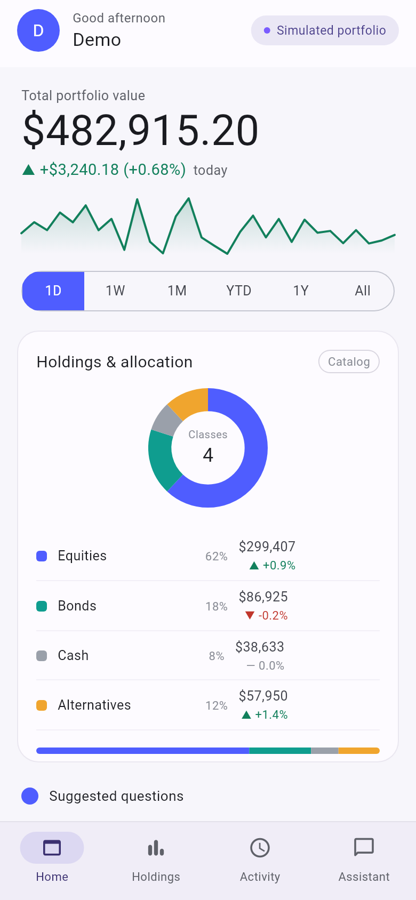

*Home on a 390 px viewport: `portfolio.summary.v1` is the hero and sparkline,
`holdings.allocation.v1` with `group_by=asset_class` is the donut. Every
figure on screen is a `display` string from those two payloads.*

## 2. Authenticate

Every route except `/health`, `/readyz`, the OpenAPI document and the agent
card needs `Authorization: Bearer <token>`. Locally, the preview sign-in
mints one for an allow-listed e-mail:

```bash
TOKEN=$(curl -s -X POST localhost:8000/v1/preview-sign-ins \
  -H "Content-Type: application/json" -d '{"email":"demo@somnio.dev"}' \
  | python3 -c 'import sys,json; print(json.load(sys.stdin)["access_token"])')
```

```http
HTTP/1.1 201 Created
{"access_token":"eyJhbGciOiJIUzI1NiIsInR5cCI6IkpXVCJ9.…","token_type":"Bearer","expires_in":28800}
```

Without it, a view read answers an RFC 9457 problem document — the error
shape every `/v1/**` route uses:

```json
{"type":"https://errors.finance-a2ui/auth/missing-token","title":"Unauthorized","status":401,
 "detail":"No bearer token was supplied.","instance":"/v1/portfolios/current/views","request_id":"1af2250f-…"}
```

Branch on the `type` suffix (`auth/missing-token`), never on `detail`, which
is prose.

## 3. Discover what you can ask for: `GET /v1/views`

The catalog is the introspection surface (ADR-K D-8). One entry per
registered projection, all of it derived from the registry — nothing here
is hand-written, so it cannot disagree with what the read endpoint serves.

```bash
curl -s -H "Authorization: Bearer $TOKEN" localhost:8000/v1/views \
  | python3 -c 'import sys,json; [print(v["id"], "→", v["component"]) for v in json.load(sys.stdin)]'
```

Each entry (`ViewDescriptor`) carries:

| Key | What it is for |
|---|---|
| `id` | The versioned view id you send back as `view=` |
| `component` | The single string the Flutter client registers a widget under — read from the projection's own A2UI adapter |
| `summary` | One sentence of purpose |
| `endpoints` | Where it is served: both endpoints, for all eleven today |
| `options_schema` | The JSON Schema of the declared options — the **only** knobs you may send (§6) |
| `fields` | The frozen field inventory: one row per payload path with `type`, `presence`, `binding`, `state`, `input` (§5 and the companion guide) |
| `example` | A rendered example payload over the sample portfolio — what a component test binds |
| `prompt` | The lines the system prompt teaches the model about this view (spec 0034) |
| `guidance` | The designer's `use_when` / `avoid_when` pair, or `null` where design has not written one |
| `actions` | What a surface may send *back* as a new agent turn — declared choices, not free text (§8) |

A slice of the waterfall's entry, as served:

```json
{
  "id": "attribution.waterfall.v1",
  "component": "AttributionWaterfall",
  "summary": "Unrealised profit and loss walked from cost basis to market value, one bucket per holding, biggest move first.",
  "endpoints": ["GET /v1/portfolios/{portfolio_id}/views", "POST /v1/view-renders"],
  "options_schema": {"properties": {"fields": {…}, "locale": {"enum": ["en-US", "es-AR", "de-DE"], …},
                     "precision": {"minimum": 0, "maximum": 8, …}, "currency": {"const": "USD", …}},
                     "additionalProperties": false, …},
  "fields": [
    {"path": "view",                  "type": "const 'attribution.waterfall.v1'", "presence": "default `\"attribution.waterfall.v1\"`", "binding": "constant",  "state": null,      "input": null},
    {"path": "title",                 "type": "string ≤120 chars", "presence": "required",     "binding": "text",      "state": null,      "input": null},
    {"path": "net.direction",         "type": "enum up / down / flat", "presence": "required", "binding": "enum",      "state": "variant", "input": null},
    {"path": "buckets",               "type": "array",             "presence": "default `[]`", "binding": "container", "state": "empty",   "input": null},
    {"path": "buckets[].key",         "type": "string ≤32 chars",  "presence": "required",     "binding": "text",      "state": null,      "input": null},
    {"path": "buckets[].delta.amount","type": "decimal",           "presence": "required",     "binding": "raw",       "state": null,      "input": null},
    {"path": "buckets[].delta.display","type": "string ≤32 chars", "presence": "required",     "binding": "display",   "state": null,      "input": null},
    …
  ],
  "actions": [{"action": "drill.attribution.v1", "label": "Break this down", "arg": "driver", "control": "choice",
               "choices": ["AAPL", "AGG", "AMD", "AVGO", "BND", "GLD", "JNJ", "MSFT", "NVDA", "PG", "PYPL", "TIP", "TSLA", "USD", "VNQ", "VOO", "XOM"], "pattern": null}],
  "guidance": {"use_when": "the user asks WHY a value changed and the answer decomposes into signed contributions…",
               "avoid_when": "a static breakdown of what is held now — `holdings.allocation.v1` answers that. Never write the figures yourself…"},
  "prompt": "- attribution.waterfall.v1 — Unrealised profit and loss walked …\n  options: fields (list of up to 8 (text), or omit it), locale (one of 'en-US', 'es-AR', 'de-DE'), precision (integer 0..8), currency (only 'USD')\n  use when: …\n  do not use for: …",
  "example": {"view": "attribution.waterfall.v1", "title": "Unrealised P/L attribution", …}
}
```

The same catalog is published twice more, from the same render pass, as
checked-in files: [`docs/catalog/CONTRACT.md`](../catalog/CONTRACT.md) for
the designer and [`docs/catalog/view-catalog.snapshot.json`](../catalog/view-catalog.snapshot.json)
for the client's tests. The running app draws it as a gallery at
`/#/catalog`, every card rendered from the entry's real `example`:

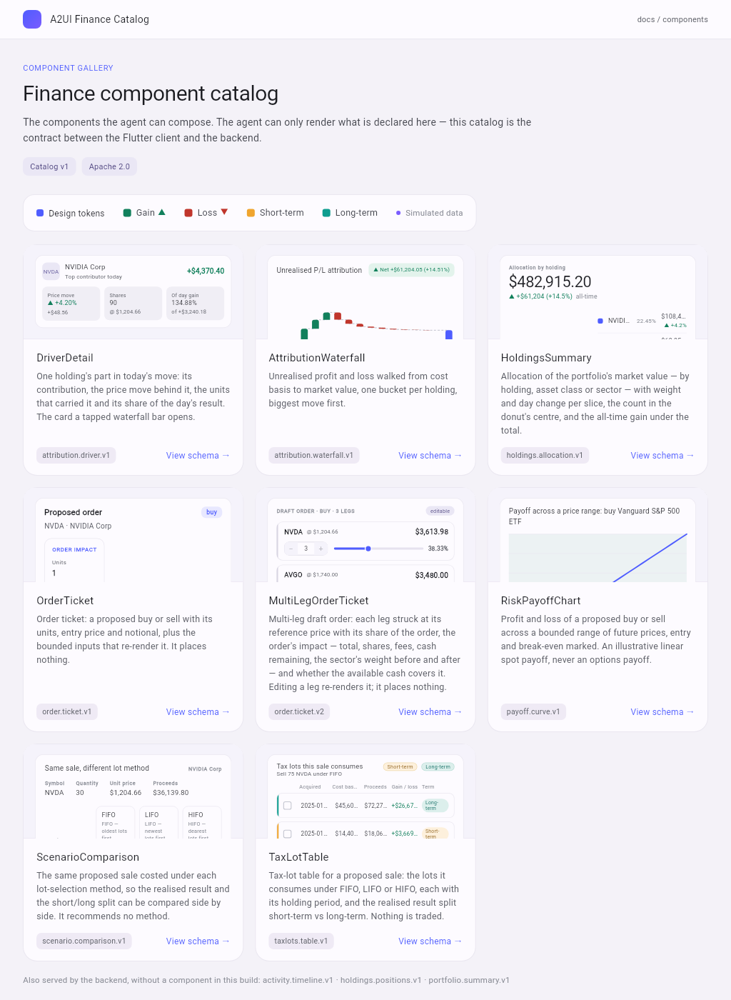

## 4. Read one chart: `GET /v1/portfolios/current/views?view=<id>`

`current` is the only portfolio id today; it resolves to the caller's own
portfolio. The request path for one chart:

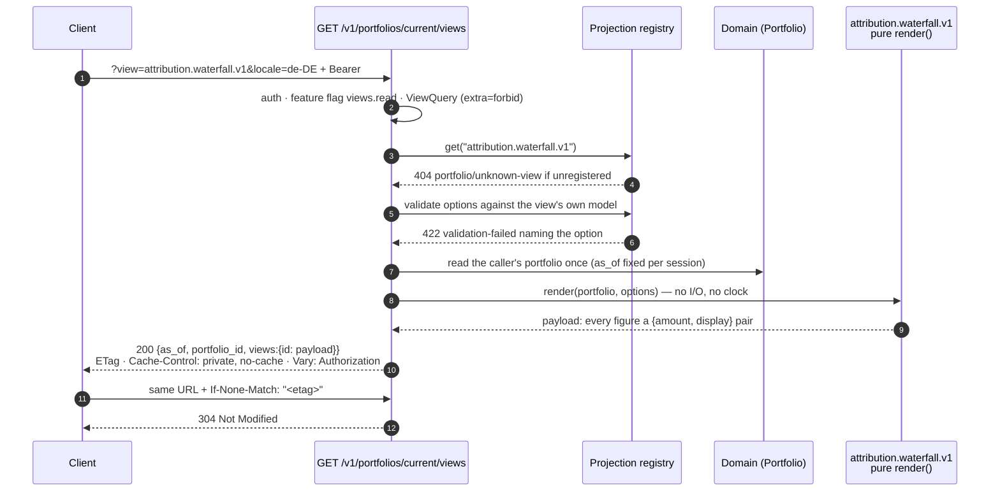

The call, and the envelope it answers (the `views` object is keyed by view
id — the same shape whether you asked for one view or four):

```bash
curl -s -D - -H "Authorization: Bearer $TOKEN" \
  "localhost:8000/v1/portfolios/current/views?view=attribution.waterfall.v1"
```

```http
HTTP/1.1 200 OK
content-type: application/json
etag: "cc66d1e0eeb006c5d02329a0da79e304b8314d30e931f4a6f8630a81ba899ae5"
cache-control: private, no-cache
vary: Authorization
x-request-id: ea0d2447-0d0a-40cc-909b-a21d53c1e2ed

{
  "as_of": "2026-09-22T13:48:16.650046Z",
  "portfolio_id": "current",
  "views": {
    "attribution.waterfall.v1": {
      "view": "attribution.waterfall.v1",
      "title": "Unrealised P/L attribution",
      "start": {"label": "Cost basis",   "amount": {"amount": "421711.15…", "display": "$421,711.15"}},
      "end":   {"label": "Market value", "amount": {"amount": "482915.20…", "display": "$482,915.20"}},
      "net":   {"label": "Net",
                "amount":  {"amount": "61204.05…", "display": "+$61,204.05"},
                "percent": {"value": "0.1451326340316114477883736297", "display": "+14.51%"},
                "direction": "up"},
      "buckets": [
        {"label": "NVIDIA Corp", "key": "NVDA",
         "delta":      {"amount": "34019.40…",  "display": "$34,019.40"},
         "cumulative": {"amount": "455730.55…", "display": "$455,730.55"},
         "direction": "up",
         "move":  {"value": "0.45725", "display": "+45.72%"},
         "units": {"units": "90.000000000000000000", "display": "90"},
         "price": {"amount": "1204.66", "display": "$1,204.66"},
         "detail": "+45.72% · 90 sh · $1,204.66",
         "selected_label": "NVDA selected"},
        {"label": "Apple Inc.", "key": "AAPL", "delta": {"amount": "29334.00…", "display": "$29,334.00"}, …},
        … 12 more, largest move first, ending with {"key": "USD", "delta": {"display": "$0.00"}, …}
      ],
      "annotations": [
        {"label": "NVIDIA Corp", "text": "$34,019.40"},
        {"label": "Apple Inc.",  "text": "$29,334.00"},
        {"label": "Net",         "text": "$61,204.05"}
      ],
      "actions": [{"action": "drill.attribution.v1", "label": "Break this down", "arg": "driver",
                   "control": "choice", "choices": ["AAPL", "AGG", …, "XOM"], "pattern": null}]
    }
  }
}
```

Three things to notice, because they are the whole contract:

- **`as_of` travels in the envelope, as a string.** The client never reads
  its own clock for it (N-13).
- **The buckets arrive in the order the widget draws them.** `sort` is an
  option where a view offers one; the client never re-ranks rows (N-10).
- **The `key` is what a tap sends back.** `buckets[].key` (`"NVDA"`) is the
  value `drill.attribution.v1` accepts as its `driver`; the `label` is prose
  and cannot be sent (§8).

### 4.1 Revalidate: ETag and 304

The body is a pure function of *(subject, greeting, portfolio, views,
options, `as_of`)*, so it carries a **strong** `ETag`. Echo it back verbatim
— the quotes are part of the tag — and an unchanged body is not sent again:

```bash
curl -s -i -H "Authorization: Bearer $TOKEN" \
  -H 'If-None-Match: "cc66d1e0eeb006c5d02329a0da79e304b8314d30e931f4a6f8630a81ba899ae5"' \
  "localhost:8000/v1/portfolios/current/views?view=holdings.allocation.v1&view=attribution.waterfall.v1"
```

```http
HTTP/1.1 304 Not Modified
etag: "cc66d1e0eeb006c5d02329a0da79e304b8314d30e931f4a6f8630a81ba899ae5"
cache-control: private, no-cache
vary: Authorization
```

A 304 is a **success**: the client resolves it to the cached envelope.
`Cache-Control` is `private, no-cache` on purpose — the body is
subject-scoped, and a feature flag can switch a route off at any moment, so
the client may keep the body but must ask before reusing it.

### 4.2 Several charts in one round trip

Repeat `view=` up to **4** times. One authentication, one session, one
portfolio read, *N* pure renders, one keyed object (ADR-K D-17):

```bash
curl -s -H "Authorization: Bearer $TOKEN" \
  "localhost:8000/v1/portfolios/current/views?view=holdings.allocation.v1&view=attribution.waterfall.v1" \
  | python3 -c 'import sys,json; d=json.load(sys.stdin); print(d["as_of"], list(d["views"]))'
# 2026-09-22T13:48:16.650046Z ['holdings.allocation.v1', 'attribution.waterfall.v1']
```

The option set is **flat and shared**: `?view=a&view=b&precision=0` applies
`precision` to both, and an option only one of them declares fails the whole
request with a 422 (§6). The `frontend/` client mirrors the cap as
`ViewsRepository.maxViewsPerRequest = 4` and chunks a screen that wants more.

### 4.3 Let the backend choose

Omit `view=` and the documented **selection rule** (ADR-K D-13) picks from
the data: every projection scores its own `fitness` over the portfolio, the
highest wins, and the endpoint's default (`holdings.allocation.v1`) is used
only when nothing scores above zero. Against the seeded portfolio, which
holds both winners and losers, the waterfall wins:

```bash
curl -s -H "Authorization: Bearer $TOKEN" "localhost:8000/v1/portfolios/current/views" \
  | python3 -c 'import sys,json; print(list(json.load(sys.stdin)["views"]))'
# ['attribution.waterfall.v1']
```

Eight of the eleven views have `fitness = 0`: they are asked for by id and
never volunteered (a tax-lot table with no sale in mind would be noise).

### 4.4 Heterogeneous batches: `POST /v1/view-renders`

When the views span different portfolios or need **different options per
view**, the batch is a resource (ADR-K D-18): up to **8** entries, a `201`
whenever the batch itself was well formed, and **a status per entry**, so one
bad view never sinks the others. Nothing durable is created, so there is no
`Location` header.

```bash
cat > batch.json <<'EOF'
{"renders":[
  {"view":"portfolio.summary.v1",   "portfolio_id":"current", "options":{}},
  {"view":"payoff.curve.v1",        "portfolio_id":"current", "options":{"size":"2"}},
  {"view":"totally.invented.v9",    "portfolio_id":"current", "options":{}},
  {"view":"holdings.allocation.v1", "portfolio_id":"current", "options":{"top_n":99}}
]}
EOF
curl -s -i -H "Authorization: Bearer $TOKEN" -H "Content-Type: application/json" \
  -d @batch.json localhost:8000/v1/view-renders
```

```http
HTTP/1.1 201 Created

{"results": [
  {"status": 200, "view": "portfolio.summary.v1", "portfolio_id": "current", "as_of": "2026-09-22T13:48:16.650046Z",
   "payload": {"view": "portfolio.summary.v1", "greeting": "Good afternoon", …}},
  {"status": 200, "view": "payoff.curve.v1", "portfolio_id": "current", "as_of": "2026-09-22T13:48:16.650046Z",
   "payload": {"view": "payoff.curve.v1", "title": "Payoff across a price range: buy Vanguard S&P 500 ETF", …}},
  {"status": 404, "view": "totally.invented.v9", "portfolio_id": "current",
   "error": {"type": "https://errors.finance-a2ui/portfolio/unknown-view", "title": "Not Found", "status": 404,
             "detail": "view 'totally.invented.v9' is not registered"}},
  {"status": 422, "view": "holdings.allocation.v1", "portfolio_id": "current",
   "error": {"type": "https://errors.finance-a2ui/validation-failed", "title": "Unprocessable Entity", "status": 422,
             "detail": "view 'holdings.allocation.v1' rejected option(s) ['top_n']"}}
]}
```

(`top_n` is bounded `1..20`; `99` is out of range, so the entry is refused
by the projection's own options model — exactly as the `?view=` path would
refuse it.) A batch is not revalidated: `ETag` covers the two `GET` reads only.

## 5. The pair convention — raw for the plot, display for the text

Every figure is an [ADR-E](../adr/ADR-E-money-representation.md) **pair**:
an exact decimal serialised as a string, beside the string the user reads.

```json
"delta":   {"amount": "34019.40000000000000000000", "display": "$34,019.40"}
"percent": {"value":  "0.1451326340316114477883736297", "display": "+14.51%"}
"units":   {"units":  "90.000000000000000000", "display": "90"}
```

| Member | Binding in `fields[]` | The client may… | The client may never… |
|---|---|---|---|
| `display` | `display` | print it, verbatim, as the figure | prepend a sign or symbol, re-round, re-localise |
| `amount` / `value` / `units` | `raw` | turn it into a **coordinate** — a bar height, a point on a line, a donut angle | print it, sum it, compare it to pick a colour |

The sign is **baked into** the display string (`"+$61,204.05"`,
`"-$10,500.00"`). Colour comes from the supplied enum (`direction`, `trend`,
`tone`), not from parsing the string. If a number must appear on screen and
only a raw member carries it, **the payload is missing a field — raise it**
(N-3); the `frontend/` client throws `PayloadContractException` naming the
path rather than formatting the raw value.

Here is that rule made visible. Both charts below were drawn by a script from
the payloads captured above: the marks are placed from the raw members, and
**every label is a `display` string copied from the same payload**. The y
tick labels on the waterfall are the one thing the script formatted itself,
and they are the one thing a client would not draw.

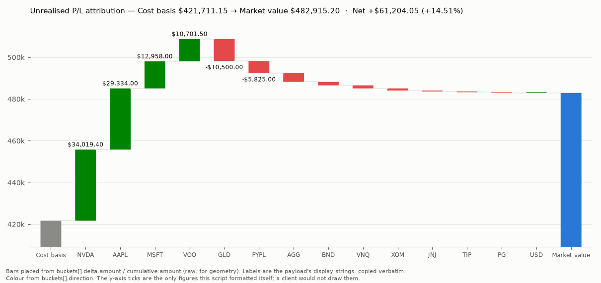

![payoff.curve.v1 drawn from the captured payload: the line from points[].at.amount and value.amount, every tick a display string](assets/payoff_from_payload.png)

Why it matters for a chart specifically: a chart library that generates its
own axis labels formats numbers inside a dependency, which breaks this rule
silently. That is why `frontend/` ports d3's *arithmetic* (scales, ticks,
layout) into a pure-Dart package and paints with `CustomPainter`, rather than
adopting `fl_chart` or `graphic` (ADR-L D-13). The value-to-pixel mapping is
the only arithmetic a client performs, and it is confined to one file
(`raw_decimal.dart`) reachable only through `ViewPayload.geometry(path)`
(ADR-L D-14).

## 6. Options: the only way a payload varies

Each view publishes a **bounded, defaulted, documented** options model
(`options_schema` in the catalog). Send an option as a query parameter and
the same view re-renders differently. Nothing else is interpreted — no field
paths, no templates, no expressions (ADR-K D-3).

```bash
# German locale, whole dollars — every string re-renders, nothing else moves
curl -s -H "Authorization: Bearer $TOKEN" \
  "localhost:8000/v1/portfolios/current/views?view=attribution.waterfall.v1&locale=de-DE&precision=0"
# "start": {"label": "Cost basis", "amount": {"amount": "421711.15…", "display": "421.711 $"}}
# "net":   {…, "amount": {"display": "+61.204 $"}, "percent": {"display": "+15%"}, "direction": "up"}

# Trim the sections the widget does not bind (ADR-K D-21)
curl -s -H "Authorization: Bearer $TOKEN" \
  "localhost:8000/v1/portfolios/current/views?view=attribution.waterfall.v1&fields=buckets"
# "buckets": [… 14 …], "annotations": []

# Fewer slices, alphabetical, rest folded into Other
curl -s -H "Authorization: Bearer $TOKEN" \
  "localhost:8000/v1/portfolios/current/views?view=holdings.allocation.v1&top_n=3&sort=label"
# categories[].label → ["Apple Inc.", "Cash & sweep", "Exxon Mobil", "Other"]

# Slice the donut by sector instead of holding
curl -s -H "Authorization: Bearer $TOKEN" \
  "localhost:8000/v1/portfolios/current/views?view=holdings.allocation.v1&group_by=sector"
# "title": "Holdings & allocation", categories → Technology 75.12% · Financials 5.45% · Healthcare 1.55% · …
```

What a rejection looks like — the message names the **option**, never its
value, so an echoed input cannot become a reflection vector:

```bash
# An option this view does not declare
curl -s -i -H "Authorization: Bearer $TOKEN" \
  "localhost:8000/v1/portfolios/current/views?view=attribution.waterfall.v1&top_n=3"
```

```http
HTTP/1.1 422 Unprocessable Entity
{"type":"https://errors.finance-a2ui/validation-failed","title":"Unprocessable Entity","status":422,
 "detail":"view 'attribution.waterfall.v1' rejected option(s) ['top_n']","instance":"/v1/portfolios/current/views","request_id":"e7681db9-…"}
```

```bash
# A section this view does not offer
…?view=attribution.waterfall.v1&fields=nope
# 422 validation-failed · "unknown section(s) ['nope']; this view offers ['buckets', 'annotations']"

# Out of range, or a parameter the endpoint itself does not know (ViewQuery is extra="forbid")
…?view=attribution.waterfall.v1&precision=99
…?view=attribution.waterfall.v1&sparkle=1
# 422 malformed-request · "1 request field(s) failed validation"

# A view that does not exist
…?view=totally.invented.v9
# 404 portfolio/unknown-view · "view 'totally.invented.v9' is not registered"
```

Two rules for a client: send only ids from `GET /v1/views` (N-6) and only
options the view's `options_schema` declares (N-7); do **not** re-validate a
server bound with a stricter client rule beside it (N-8) — the bound the
server publishes is the bound it enforces, and a test walks the registry to
prove it.

## 7. Every projection, as served

One captured excerpt per view, trimmed to the shape. Field-by-field
inventories live in [`CONTRACT.md`](../catalog/CONTRACT.md).

### `portfolio.summary.v1` — `PortfolioSummary`

Options: `locale`, `precision`, `currency`, `range`. The greeting and account
are server-written; `spark[]` is thirty `{label, value}` observations.

```json
{"view": "portfolio.summary.v1", "greeting": "Good afternoon", "account": {"name": "Demo", "initial": "D"},
 "badge": "Simulated portfolio",
 "total":  {"label": "Total portfolio value", "amount": {"amount": "482915.20…", "display": "$482,915.20"}},
 "change": {"amount": {"amount": "3240.18…", "display": "+$3,240.18"},
            "percent": {"value": "0.006754948381510465147841136276", "display": "+0.68%"}, "trend": "up", "period": "today"},
 "spark": [{"label": "08/24/2026", "value": {"amount": "483925.09…", "display": "$483,925.09"}}, … 30 points …],
 "questions_title": "…", "questions": [...], "movers_title": "Top movers today", "movers": [...]}
```

### `holdings.allocation.v1` — `HoldingsSummary`

Options: `top_n` (1..20), `include_other`, `sort`, `locale`, `precision`,
`currency`, `group_by` (`holding | asset_class | sector`), `headline`. The
Home card asks for `headline=false` because the shell already draws the hero.

```json
{"view": "holdings.allocation.v1", "title": "Allocation by holding", "group_by": "holding",
 "total": {"label": "Total market value", "amount": {"amount": "482915.20…", "display": "$482,915.20"}},
 "total_gain": {"amount": {"display": "+$61,204", …}, "percent": {"display": "+14.5%", …}, "trend": "up", "period": "all-time"},
 "center": {"count": "14", "unit": "Holdings"},
 "categories": [
   {"label": "NVIDIA Corp", "key": "NVDA", "value": {"amount": "108419.40…", "display": "$108,419.40"},
    "weight": {"value": "0.2245102245694482178237504224", "display": "22.45%"},
    "change": {"value": "0.04200328691289680823458178358", "display": "+4.2%"}, "trend": "up"},
   … {"label": "Other", "key": "other", "value": {"display": "$163,631.80", …}, "weight": {"display": "33.88%", …}, …}]}
```

`center.count` is a **string** (`"14"`): a count the widget prints is text,
not a number it may do arithmetic on.

### `holdings.positions.v1` — `PositionList`

Options: `sort`, `locale`, `precision`, `currency`. Each row carries a
server-written `detail` (`"90 sh · avg $826.67"`) and an `ask.text` the row's
button sends to the assistant.

```json
{"view": "holdings.positions.v1", "title": "Holdings",
 "total": {"label": "Total value", "amount": {"display": "$482,915.20", …}},
 "gain": {"amount": {"display": "+$61,204", …}, "percent": {"display": "+14.5%", …}, "trend": "up", "period": "all-time unrealized"},
 "ask_label": "Ask the assistant about this",
 "positions": [{"symbol": "NVDA", "name": "NVIDIA Corp", "detail": "90 sh · avg $826.67",
                "value": {"display": "$108,419.40", …}, "unrealized": {"amount": {"display": "+$34,019", …}, "percent": {"display": "+45.7%", …}, "trend": "up", "period": "all-time"},
                "day": {"value": "0.0420…", "display": "+4.2%"}, "day_trend": "up", "price": {"display": "$1,204.66", …},
                "weight": {"display": "22.5%", …}, "is_cash": false, "ask": {"text": "Tell me about my NVDA position"}}, …]}
```

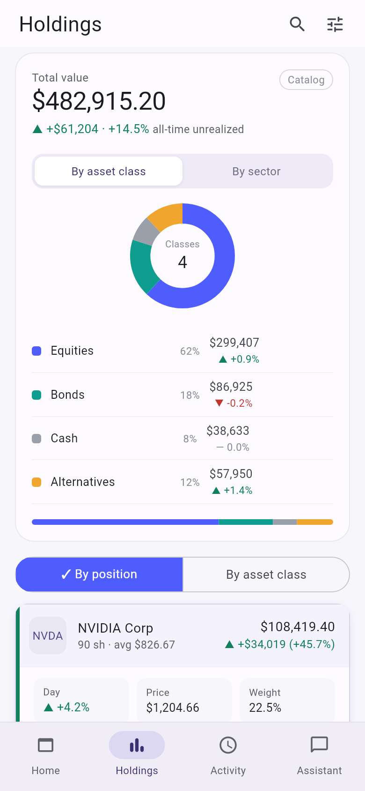

### `activity.timeline.v1` — `ActivityTimeline`

Options: `locale`, `precision`, `currency`, `kind` (`all | buy | sell |
dividend | deposit`), `limit`. The filter chips are the payload's
`filters[]`; tapping one re-requests the view with `kind=<key>` — the filter
is an option, so the client never filters rows itself.

```json
{"view": "activity.timeline.v1", "title": "Activity", "note": "Simulated activity — resets each session.", "kind": "all",
 "filters": [{"key": "all", "label": "All"}, {"key": "buy", "label": "Buys"}, {"key": "sell", "label": "Sells"},
             {"key": "dividend", "label": "Dividends"}, {"key": "deposit", "label": "Deposits"}],
 "groups": [{"label": "TODAY", "entries": [{"key": "txn-0017", "kind": "dividend", "title": "Dividend — VOO",
              "detail": "$1.62/sh · 85 sh · qualified", "amount": {"amount": "137.70…", "display": "+$137.70"},
              "tone": "up", "badge": "Dividend", "realized": null, "term": null}]},
            {"label": "THIS WEEK", "entries": [...]}, {"label": "SEPTEMBER 2026", "entries": [...]}, …]}
```

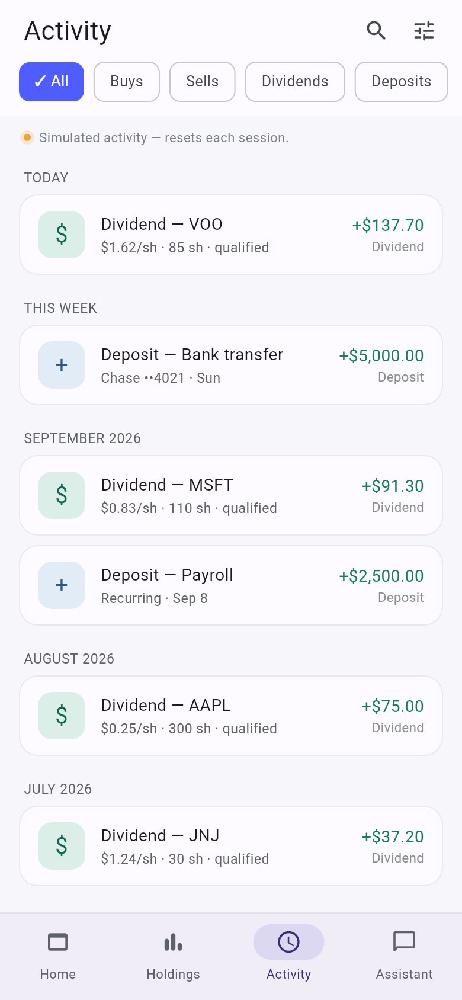

### `attribution.waterfall.v1` — `AttributionWaterfall`

Shown in full in §4. Options: `fields`, `locale`, `precision`, `currency`.
The only view that declares an **action** today (§8).

### `attribution.driver.v1` — `DriverDetail`

Options: `locale`, `precision`, `currency`, `symbol`. The card a tapped
waterfall bar opens; `symbol` is the option, and the payload echoes it under
the same name, so the catalog reports it editable.

```json
{"view": "attribution.driver.v1", "symbol": "NVDA", "name": "NVIDIA Corp", "caption": "Top contributor today",
 "contribution": {"amount": "4370.40…", "display": "+$4,370.40"}, "trend": "up",
 "price_move": {"label": "Price move", "percent": {"display": "+4.20%", …}, "amount": {"display": "+$48.56", …}, "trend": "up"},
 "shares": {"label": "Shares", "units": {"units": "90.000000000000000000", "display": "90"}, "price": {"display": "$1,204.66", …}, "caption": "@ $1,204.66"},
 "day_share": {"label": "Of day gain", "percent": {"value": "1.348813954780289983889783901", "display": "134.88%"},
               "total": {"display": "+$3,240.18", …}, "caption": "of +$3,240.18"}}
```

### `taxlots.table.v1` — `TaxLotTable`

Options: `fields`, `locale`, `precision`, `currency`, `symbol`, `quantity`,
`lot_method` (`FIFO | LIFO | HIFO`). `by_term[]` is the short/long split
**pre-computed**; `lots[].lots` counts are integers the widget prints, never
sums.

```json
{"view": "taxlots.table.v1", "title": "Tax lots this sale consumes", "subtitle": "Sell 75 NVDA under FIFO",
 "proceeds":   {"label": "Proceeds",     "amount": {"display": "$90,349.50", …}},
 "cost_basis": {"label": "Cost basis",   "amount": {"display": "$60,000.00", …}},
 "realized":   {"label": "Realised P/L", "amount": {"display": "+$30,349.50", …}},
 "by_term": [{"label": "Short-term", "term": "short", "lots": 1, "realized": {"display": "+$3,669.90", …}},
             {"label": "Long-term",  "term": "long",  "lots": 1, "realized": {"display": "+$26,679.60", …}}],
 "lots": [{"label": "lot-nvda-01", "acquired_on": "2025-09-20", "acquired_on_display": "09/20/2025", "term": "long",
           "units": "60.000000000000000000", "units_display": "60", "cost_basis": {"display": "$45,600.00", …},
           "proceeds": {"display": "$72,279.60", …}, "gain_loss": {"display": "+$26,679.60", …}, "trend": "up", "fully_sold": true}, …]}
```

### `scenario.comparison.v1` — `ScenarioComparison`

Options: `locale`, `precision`, `currency`, `symbol`, `quantity`, `methods`.
The `spread` block is the comparison already made: `differs`, `highest`,
`lowest` are server verdicts, so the widget highlights without comparing.

```json
{"view": "scenario.comparison.v1", "title": "Same sale, different lot method",
 "subject": {"label": "NVIDIA Corp", "symbol": "NVDA", "quantity_display": "30", "price": {"display": "$1,204.66", …}, "proceeds": {"display": "$36,139.80", …}},
 "columns": [{"method": "FIFO", "label": "FIFO — oldest lots first", "cost_basis": {"display": "$22,800.00", …},
              "realized_pl": {"display": "+$13,339.80", …}, "short_term_pl": {"display": "$0.00", …}, "long_term_pl": {"display": "+$13,339.80", …},
              "short_term_lots": 0, "long_term_lots": 1, "lots": ["lot-nvda-01"]},
             {"method": "LIFO", …}, {"method": "HIFO", …}],
 "spread": {"amount": {"display": "$6,000.00", …}, "differs": true, "highest": "FIFO", "lowest": "LIFO"},
 "notes": [{"label": "Before tax", "text": "The realised result and its short/long split, before any tax rate, fee or wash-sale rule."},
           {"label": "Not advice", "text": "No method is recommended: …"}]}
```

`notes[]` and `disclosure` strings are compliance statements: render them
verbatim, never drop them (N-9).

### `payoff.curve.v1` — `RiskPayoffChart`

Options: `fields`, `locale`, `precision`, `currency`, `symbol`, `size`
(**integer** 1..1000000000, default `500` — a whole number, because a JSON
float can no longer be made exact, ADR-E D-5), `size_in` (`units | usd`,
default `usd`), `side`, `range_pct` (5..90, default 30), `steps` (1..25,
default 12). `markers.break_even.at` and `markers.current.at` are placed by
**field path**, not by matching a label.

```json
{"view": "payoff.curve.v1", "title": "Payoff across a price range: buy Vanguard S&P 500 ETF",
 "disclosure": "Illustrative linear spot payoff on the demo portfolio's simulated prices: …",
 "markers": {"break_even": {"label": "Break-even", "at": {"amount": "528.00", "display": "$528.00"}},
             "current":    {"label": "Current price", "at": {"amount": "528.00", "display": "$528.00"}}},
 "totals": [{"label": "Entry price", "amount": {"display": "$528.00", …}}, {"label": "Break-even price", …}, {"label": "Notional", "amount": {"display": "$500.00", …}}],
 "series": [{"name": "Profit / loss", "points": [
   {"label": "$369.60", "at": {"amount": "369.600", "display": "$369.60"}, "value": {"amount": "-150.00…", "display": "-$150.00"}},
   … 25 points …,
   {"label": "$686.40", "at": {"amount": "686.400", "display": "$686.40"}, "value": {"amount": "150.00…", "display": "$150.00"}}]}],
 "annotations": [...]}
```

`points[].at` is the **x** coordinate as a pair: a client given only the
`label` would have to parse `"$369.60"` back into a number to place the
point, which is the arithmetic ADR-K D-5 removes.

### `order.ticket.v1` — `OrderTicket`

Options: `locale`, `precision`, `currency`, `symbol`, `side`, `size`
(string, `^[0-9]{1,9}(\.[0-9]{1,8})?$`), `size_in` (`units | usd`). The
first interactive projection: `inputs[]` publishes one descriptor per
editable option with its **current value and its bound**, and the payload
echoes `symbol`, `side`, `size`, `size_in` under the option names.

```bash
…?view=order.ticket.v1&symbol=AAPL&size=500&size_in=usd
```

```json
{"view": "order.ticket.v1", "title": "Proposed order", "symbol": "AAPL", "name": "Apple Inc.", "side": "buy",
 "size": "500", "size_in": "usd",
 "quantity":    {"units": "2.144266232095376962003602367", "display": "2.14426623"},
 "entry_price": {"amount": "233.18", "display": "$233.18"},
 "notional":    {"label": "Order value", "amount": {"amount": "499.9999999999999999999999999", "display": "$500.00"}},
 "inputs": [{"option": "symbol",  "label": "Asset",   "control": "choice", "value": "AAPL", "choices": ["AAPL", "AGG", …, "XOM"], "pattern": null, "hint": null},
            {"option": "side",    "label": "Side",    "control": "choice", "value": "buy",  "choices": ["buy", "sell"], "pattern": null, "hint": null},
            {"option": "size",    "label": "Size",    "control": "text",   "value": "500",  "choices": [], "pattern": "^[0-9]{1,9}(\\.[0-9]{1,8})?$", "hint": "Up to 8 decimal places"},
            {"option": "size_in", "label": "Size in", "control": "choice", "value": "usd",  "choices": ["units", "usd"], "pattern": null, "hint": null}],
 "effect": "recalculate",
 "disclosure": "Illustrative ticket. This showcase has no broker and no execution: changing a field re-renders these figures, and nothing is ever sent, placed or settled."}
```

The division `500 / 233.18` happened **server-side**: `quantity` is an
output of the render, which is why it is *not* named after an option and
*not* editable.

### `order.ticket.v2` — `MultiLegOrderTicket`

Options: `locale`, `precision`, `currency`, `legs` (one bounded string,
`NVDA:3,AVGO:2,AMD:14`), `side`. Each line carries **`increment` and
`decrement`: the whole `legs` value the stepper sends when tapped**, composed
by the backend — so the client never adds one to a share count (N-2). The
edit round-trip is walked in [`schema-mutations.md` §3](schema-mutations.md#3-an-editable-field-is-a-payload-field-named-exactly-as-the-option-that-sets-it).

```json
{"view": "order.ticket.v2", "title": "Draft order · Buy · 3 legs", "badge": "editable", "side": "buy",
 "legs": "NVDA:3,AVGO:2,AMD:14",
 "lines": [{"key": "NVDA", "symbol": "NVDA", "name": "NVIDIA Corp", "price": {"display": "$1,204.66", …},
            "quantity": {"units": "3", "display": "3"}, "notional": {"display": "$3,613.98", …}, "weight": {"display": "38.33%", …},
            "increment": "NVDA:4,AVGO:2,AMD:14", "decrement": "NVDA:2,AVGO:2,AMD:14"},
           {"key": "AVGO", …, "increment": "NVDA:3,AVGO:3,AMD:14", "decrement": "NVDA:3,AVGO:1,AMD:14"},
           {"key": "AMD",  …, "increment": "NVDA:3,AVGO:2,AMD:15", "decrement": "NVDA:3,AVGO:2,AMD:13"}],
 "impact": {"total": {"label": "Total order", "amount": {"display": "$9,427.78", …}},
            "units": {"label": "Est. shares", "units": {"units": "19", "display": "19"}},
            "fees":  {"label": "Est. fees · sim", "amount": {"display": "$0.00", …}},
            "cash_remaining": {"label": "Cash remaining", "amount": {"display": "$29,205.44", …}},
            "weight_shifts": [{"label": "Portfolio weight · Technology", "key": "technology",
                               "before": {"display": "46.57%", …}, "after": {"display": "48.52%", …}}]},
 "constraints": {"max_cash": {"label": "Available cash", "amount": {"display": "$38,633.22", …}}, "breach": "none", "shortfall": null, "message": null},
 "disclosure": "Illustrative draft. This showcase has no broker and no execution: …", "effect": "recalculate"}
```

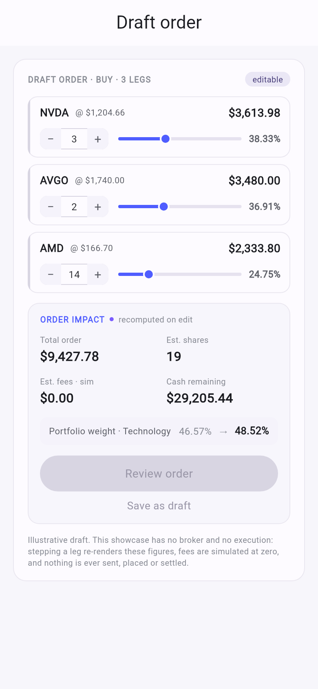

## 8. The same charts inside an agent turn (A2UI)

The assistant does not return a payload. It returns a **render intent** —
`{view, options}` picked from the registry — streamed the moment the tool
that produced it returned, and the client fetches the view through the exact
read path of §4. The full picture, including the model loop and the tool
registry, is [`docs/diagrams/05-agent-turn.md`](../diagrams/05-agent-turn.md);
this is the client's slice of it:

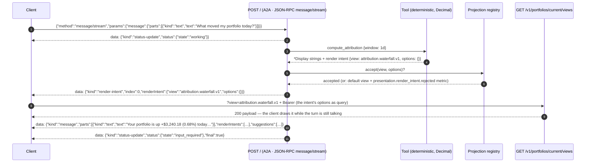

The stream, exactly as captured (this stack runs without a Gemini key, so the
**scripted** assistant of spec 0033 answers — same tools, same registry, same
event order; only the party choosing the tool call is a table instead of a
model):

```bash
curl -s -N -H "Authorization: Bearer $TOKEN" -H "Content-Type: application/json" localhost:8000/ -d '{
  "jsonrpc":"2.0","id":"1","method":"message/stream",
  "params":{"message":{"role":"user","messageId":"m-1",
            "parts":[{"kind":"text","text":"What moved my portfolio today?"}]}}}'
```

```text
data: {"kind":"status-update","taskId":"202ef0b9-…","contextId":null,"status":{"state":"working"},"final":false}

data: {"kind":"render-intent","taskId":"202ef0b9-…","contextId":null,"index":0,"renderIntent":{"view":"attribution.waterfall.v1","options":{}}}

data: {"kind":"message","taskId":"202ef0b9-…","contextId":null,"role":"agent",
       "parts":[{"kind":"text","text":"Your portfolio is up +$3,240.18 (0.68%) today. Here's what drove it:"}],
       "renderIntents":[{"view":"attribution.waterfall.v1","options":{}}],
       "suggestions":[{"key":"allocation","label":"What do I hold?"},{"key":"biggest-drivers","label":"Biggest drivers"},
                      {"key":"tax-lots","label":"Tax lots"},{"key":"why-did-i-move","label":"Why did I move?"}]}

data: {"kind":"status-update","taskId":"202ef0b9-…","contextId":null,"status":{"state":"input_required"},"final":true}
```

What a client does with each event:

| `kind` | Do |
|---|---|
| `status-update` `working` | show the turn as in progress |
| `render-intent` | `GET /v1/portfolios/current/views?view=<renderIntent.view>&<renderIntent.options as query>` and render the payload **now** — first pixel before the sentence arrives (ADR-K D-19) |
| `message` | show `parts[].text` verbatim (its figures were copied from tool output, never computed by the model); `renderIntents` repeats every intent so a client that ignored the incremental events still has the full list; `suggestions` are the chips it may offer next |
| `status-update` `final: true` | `input_required` = the turn ended and awaits the user; `completed` / `failed` as named |

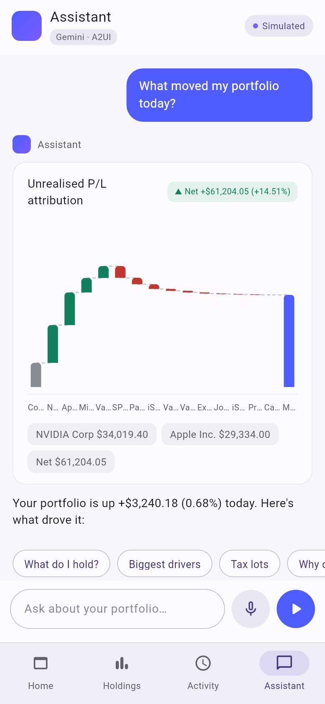

The three design flows, as the scripted assistant answers them on this build
(the chart in each case is the *tool's* choice, judged by the registry — the
script aims nothing):

| Prompt | Tool | Render intent |
|---|---|---|
| *What moved my portfolio today?* | `compute_attribution {window: 1d}` | `attribution.waterfall.v1` |
| *If I sell $20k of NVDA, what's the tax hit?* | `simulate_sale {symbol: NVDA, amount_usd: "20000", lot_method: FIFO}` | `taxlots.table.v1` |
| *Put about $10k into semiconductors, keep it diversified.* | `draft_order {amount: "10000", basket: semiconductors}` | `order.ticket.v2` with the same `legs` |

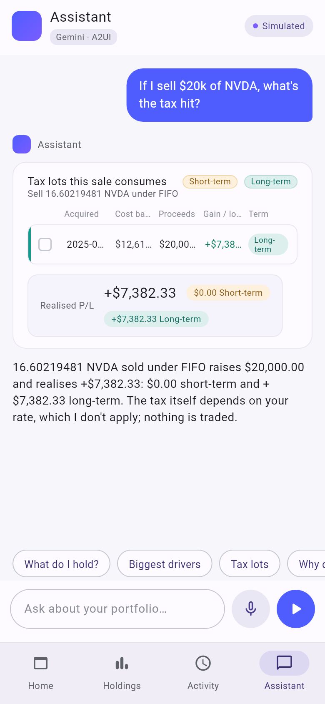
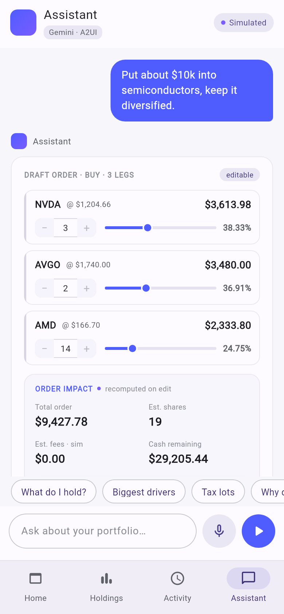

### 8.1 Sending something back: chips and taps are declared actions

A surface can send **an action id it did not invent, plus scalars drawn from
bounds the payload published** — never a sentence. It travels as A2A's own
`data` part; the prompt the turn receives is composed server-side (spec
0022). The chips in `suggestions[]` are `ask.suggested.v1` with the chip's
`key`; a tapped waterfall bar is `drill.attribution.v1` with the bar's
`buckets[].key`:

```bash
# A chip
curl -s -N -H "Authorization: Bearer $TOKEN" -H "Content-Type: application/json" localhost:8000/ -d '{
  "jsonrpc":"2.0","id":"2","method":"message/stream",
  "params":{"message":{"role":"user","messageId":"m-2",
            "parts":[{"kind":"data","data":{"action":"ask.suggested.v1","args":{"suggestion":"allocation"}}}]}}}'
# → render-intent {"view":"holdings.allocation.v1","options":{"top_n":14}}
# → message "Your portfolio is worth $482,915.20, +$61,204.05 (14.51%) on what it cost. Here is how it is allocated, largest first:"

# A tapped bar
… "parts":[{"kind":"data","data":{"action":"drill.attribution.v1","args":{"driver":"NVDA"}}}] …
# → render-intent {"view":"attribution.driver.v1","options":{"symbol":"NVDA"}}
# → message "NVIDIA Corp (NVDA) contributed +$4,370.40 today: its price moved +4.20% (+$48.56) on 90 shares at $1,204.66, 134.88% of the day's +$3,240.18."
```

Note the second intent carries an **option** (`symbol: NVDA`) the tool
filled: the client fetches `…?view=attribution.driver.v1&symbol=NVDA`,
exactly as it would for any option. An unknown action or an out-of-range
argument is a JSON-RPC `-32602` at HTTP 200 and the stream never opens;
unlike a bad render intent there is no default to fall back to.

## 9. Checklist for a new client

- [ ] Read `GET /v1/views` once; keep `id`, `component`, `options_schema`, `fields`.
- [ ] Bind every figure from a `display` string; use `amount`/`value`/`units` for coordinates only.
- [ ] Render rows, notes and disclosures in arrival order and verbatim.
- [ ] Send only catalog ids and declared options; treat 422/404 as contract errors, not retries.
- [ ] Echo `ETag` back; treat 304 as the cached body.
- [ ] Batch same-portfolio views with repeated `view=` (≤ 4); use `POST /v1/view-renders` (≤ 8) for per-view options or several portfolios.
- [ ] In a turn, fetch each `render-intent` as it arrives; send taps back as `data` parts with published values.
- [ ] A view id with no registered component is a placeholder, not an error — the catalog grows on its own schedule.
