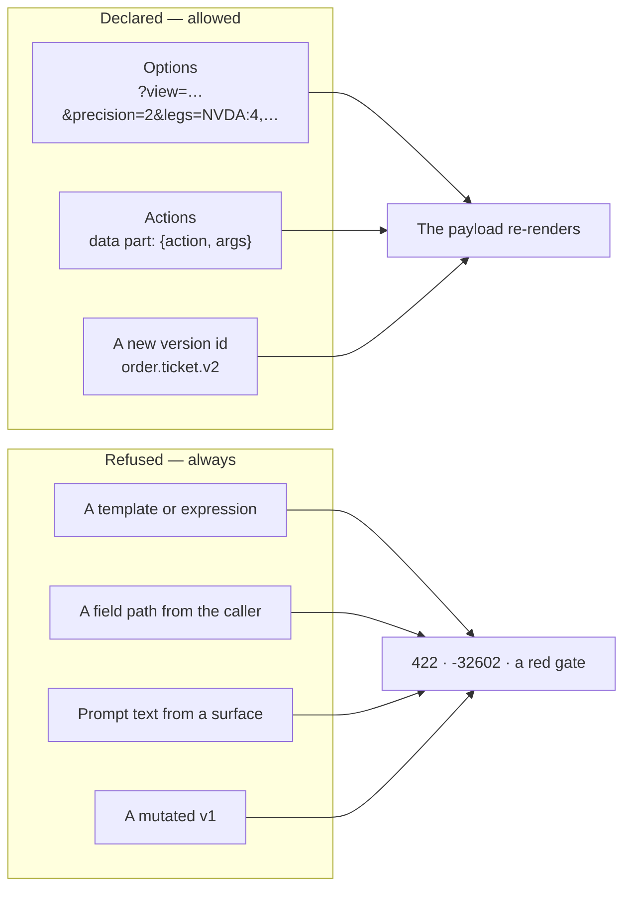
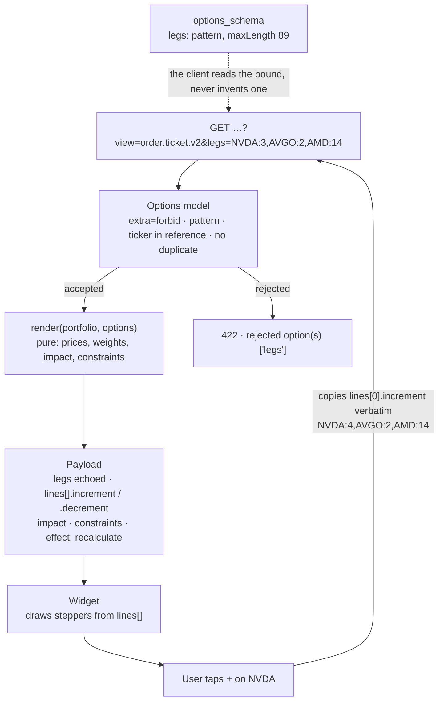
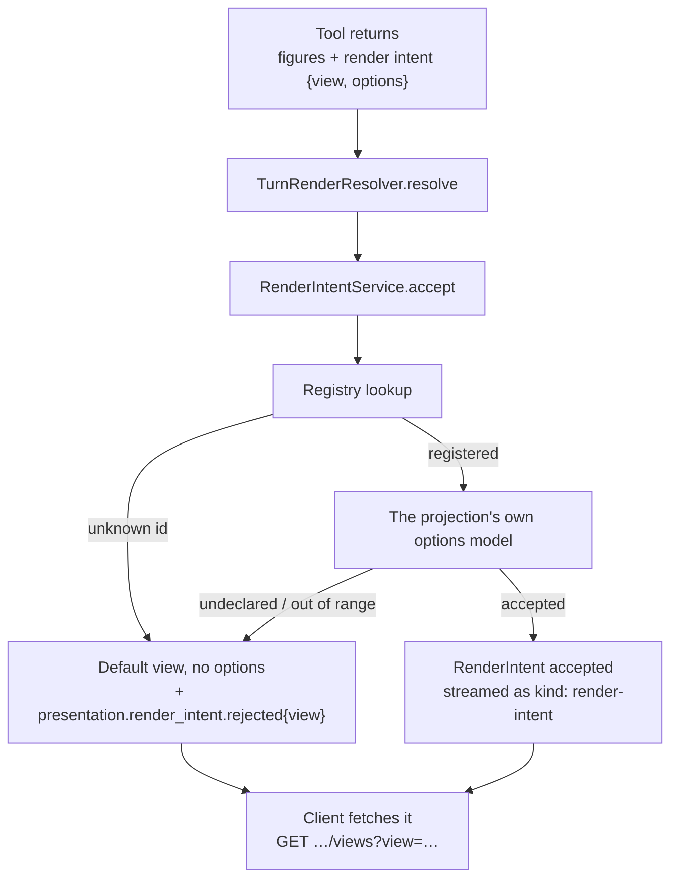
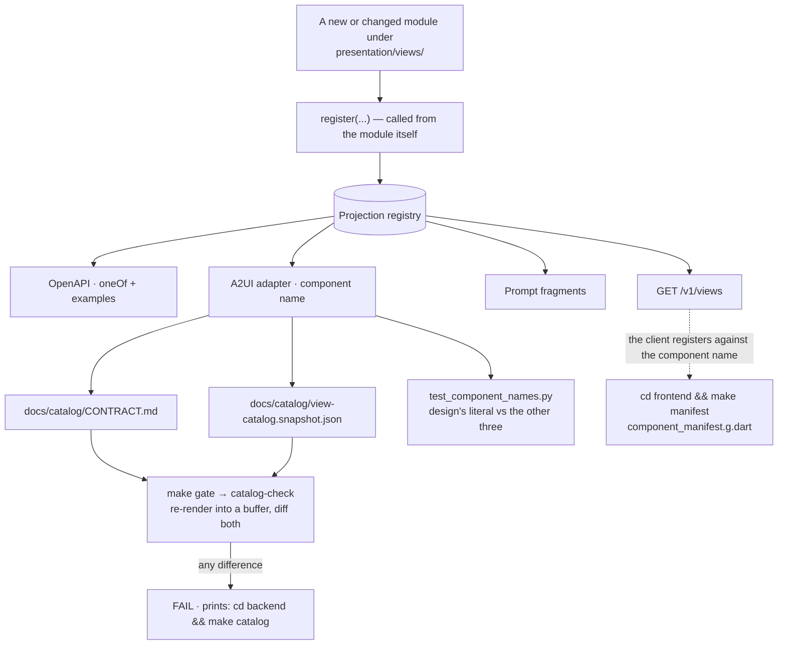
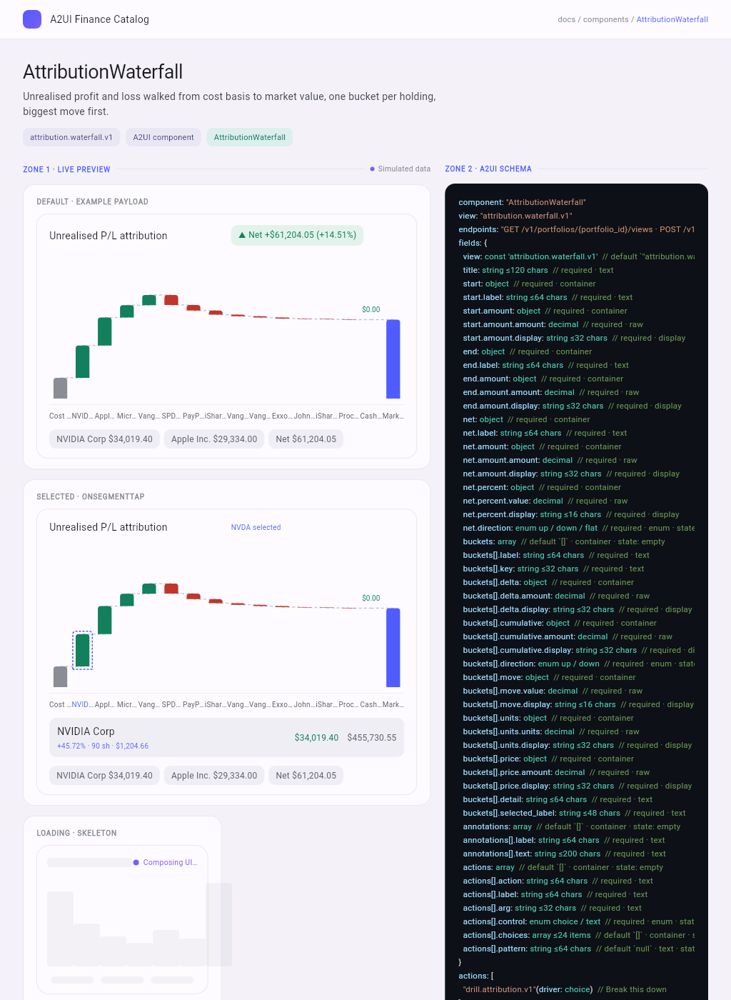
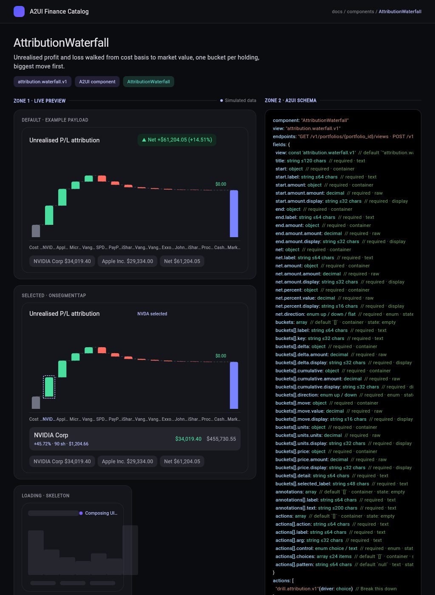

# Schema mutations — how a chart's shape is allowed to change

**Audience:** anyone adding a chart, changing one, or writing a client that
must survive both. **Companion:** [`feeding-charts.md`](feeding-charts.md),
which explains how the payloads described here are fetched. **Source of
truth:** [ADR-K](../adr/ADR-K-response-shaping.md) (D-3 declared options, D-9
versioning, D-11/D-12 render intents, D-14/D-15 the seam),
[`.claude/rules/backend/presentation.md`](../../.claude/rules/backend/presentation.md)
§6 (the checklist a new chart follows) and the specs each section cites.

Everything below was verified against a running backend on 2026-09-22
(`local+b7e78bf`); commands and responses are as they came back.

## 0. The short version

A payload may vary in exactly **two** ways, and change in exactly **one**:

| | Mechanism | Bound |
|---|---|---|
| **Varies** | a **declared option** the caller fills | the projection's own pydantic model — bounded, defaulted, described. Anything undeclared or out of range is a **422** |
| **Varies** | a **declared action** the surface sends back | a registered action id plus scalars from a published bound. Anything else is a JSON-RPC `-32602` |
| **Changes** | a **new version id** — `<component>.<variant>.v<N+1>` | the old id keeps serving, byte for byte, with its digest unmoved |

There is no third mechanism. No free-form template, no expression language, no
field-path DSL, no client-supplied prompt text. That is not an omission; ADR-K
lists the interpreter it declined and why.



---

## 1. A versioned id is a promise, and `v1` and `v2` prove it

An id is `<component>.<variant>.v<N>`. Once a client binds to
`attribution.waterfall.v1`, **that shape is fixed** (ADR-K D-9). A breaking
change arrives as a new id; it never arrives as a mutation.

The worked example is in the repository right now. The design for the
multi-leg draft order could have been argued as "the order ticket, with legs".
Spec [0024](../../specs/backend/0024-contract-serves-the-designs.md) §3 ruled
that it is not a backwards-compatible addition to `order.ticket.v1` but **a
second contract**, and [0031](../../specs/backend/0031-order-ticket-v2.md)
built it as one. Both are served today:

```console
$ curl -s -H "Authorization: Bearer $TOKEN" localhost:8000/v1/views \
    | python3 -c 'import sys,json;[print(v["id"],"→",v["component"]) for v in json.load(sys.stdin) if "order" in v["id"]]'
order.ticket.v1 → OrderTicket
order.ticket.v2 → MultiLegOrderTicket
```

| | `order.ticket.v1` | `order.ticket.v2` |
|---|---|---|
| Component | `OrderTicket` | `MultiLegOrderTicket` |
| Digest | `d0daddcb8960` | `e6c713d6a144` |
| Fields | 28 | 64 |
| Own options | `symbol`, `side`, `size`, `size_in` | `legs`, `side` |
| Shape of the edit | an `inputs[]` block, one descriptor per editable option | `legs` echoed, plus `increment` / `decrement` per line |
| Extras | — | `impact` panel, `constraints` with a cash breach |

Spec 0031 §2 states the rule as an outcome, not an intention: v1 is
*"unchanged byte for byte — its module, payload, snapshot entry and digest
`d0daddcb8960` are the same."* A digest is what makes that checkable instead
of promised (§9).

Note also what v2 did **not** get: the component name. `OrderTicket` belongs to
v1 and stays there; v2 is `MultiLegOrderTicket`. A version bump that reuses a
component name would leave the client unable to tell the two widgets apart.

**When is a change a new version rather than an option?**

| The change | It is |
|---|---|
| A new optional field the old client can ignore | an addition to `vN`, and the digest moves — see §9 |
| A field removed, renamed, retyped, or re-bounded downward | a **new version** |
| A different arrangement of the same data for the same question | an **option** (`group_by`, `sort`, `range`, `lot_method`) |
| A different question, or a different component | a **new projection** — a new id, not a new version |

Removing an id at all needs a deprecation note in `CHANGELOG.md` and a release
cycle (ADR-K D-9). Nothing has been removed yet.

---

## 2. Options are the only knob, and they are bounded

Every projection publishes a pydantic options model: each field bounded
(`ge`/`le`/`max_length`/`enum`/`const`/`pattern`), defaulted, described and
exemplified, with `additionalProperties: false` on the schema. The schema in
`GET /v1/views` **is** the schema that validates, because both come from the
same model.

```json
"legs": {
  "type": "string",
  "default": "NVDA:3,AVGO:2,AMD:14",
  "maxLength": 89,
  "pattern": "^[A-Z]{2,10}:[0-9]{1,6}(,[A-Z]{2,10}:[0-9]{1,6}){0,4}$",
  "description": "The legs of the draft as `TICKER:SHARES` pairs separated by commas, one to five of them, whole shares, each ticker from the market reference and named once. Every rendered leg carries the value a `+` or `-` sends back, so a stepper edit is this option re-sent with one number moved.",
  "examples": ["NVDA:3,AVGO:2,AMD:14", "NVDA:4,AVGO:2,AMD:14"]
}
```

Both callers — the client's `?view=` and the model's render intent — are judged
by that one model, in `presentation/resolve.py`:

```console
$ …/views?view=attribution.waterfall.v1&legs=NVDA:3          → 422
  "detail": "view 'attribution.waterfall.v1' rejected option(s) ['legs']"

$ …/views?view=attribution.waterfall.v1&fields=nope          → 422
  "detail": "unknown section(s) ['nope']; this view offers ['buckets', 'annotations']"

$ …/views?view=attribution.waterfall.v1&precision=99          → 422
$ …/views?view=attribution.waterfall.v1&sparkle=1             → 422
  "detail": "1 request field(s) failed validation"
```

Two details worth copying into any new options model:

- **The rejection names the option, never its value.** An echoed input is how a
  rejection becomes a reflection vector.
- **Unknown is rejected, not ignored.** A best-effort render of an option the
  server did not understand is a payload nobody can reason about.

---

## 3. An editable field is a payload field named exactly as the option that sets it

This is the whole interactivity declaration, and it is a **naming rule**, not a
list. From [`.claude/rules/backend/presentation.md`](../../.claude/rules/backend/presentation.md) §4:

> An editable field is a payload field named exactly as the option that sets
> it. That naming *is* the interactivity declaration; a component with an
> input that does not round-trip through a declared option breaks D-3.

The contract generator applies exactly that test when it fills the `input`
column, which is why the answer is derived rather than curated:

```json
{"path": "side", "binding": "enum", "state": "variant",
 "input": "input · one of 'buy', 'sell'"}
{"path": "legs", "binding": "text", "state": null,
 "input": "input · string matching ^[A-Z]{2,10}:[0-9]{1,6}(,[A-Z]{2,10}:[0-9]{1,6}){0,4}$"}
```

`order.ticket.v2` has 64 fields and exactly those two are editable, because
exactly those two are named after options. `lines[].notional` is an **output**
of the render — no option is called `notional`, so nothing offers to edit it.
The same test explains `attribution.driver.v1`: it echoes `symbol` under the
option's own name, so the catalog reports `symbol` editable and nothing else.

### The three shapes this takes today

**(a) `order.ticket.v1` — an `inputs[]` descriptor block.** One entry per
editable option, carrying its current value and its bound, so the widget
renders the control from the payload rather than from a hardcoded form:

```json
"inputs": [
  {"option": "symbol",  "label": "Asset",   "control": "choice", "value": "NVDA",
   "choices": ["AAPL", "AGG", "AMD", "…", "XOM"], "pattern": null, "hint": null},
  {"option": "side",    "label": "Side",    "control": "choice", "value": "buy",
   "choices": ["buy", "sell"], "pattern": null, "hint": null},
  {"option": "size",    "label": "Size",    "control": "text",   "value": "3",
   "choices": [], "pattern": "^[0-9]{1,9}(\\.[0-9]{1,8})?$", "hint": "Up to 8 decimal places"}
]
```

**(b) `order.ticket.v2` — the next value, precomputed per leg.** The design's
stepper adds one to a share count. Adding one is arithmetic, and the client may
not perform arithmetic even once (N-2). So the payload hands it the answer:
every line carries the **whole `legs` value** a `+` or `−` sends back.

```json
"legs": "NVDA:3,AVGO:2,AMD:14",
"lines": [
  {"key": "NVDA", "quantity": {"units": "3",  "display": "3"},
   "increment": "NVDA:4,AVGO:2,AMD:14", "decrement": "NVDA:2,AVGO:2,AMD:14"},
  {"key": "AVGO", "quantity": {"units": "2",  "display": "2"},
   "increment": "NVDA:3,AVGO:3,AMD:14", "decrement": "NVDA:3,AVGO:1,AMD:14"},
  {"key": "AMD",  "quantity": {"units": "14", "display": "14"},
   "increment": "NVDA:3,AVGO:2,AMD:15", "decrement": "NVDA:3,AVGO:2,AMD:13"}
]
```

A tap is not an event the client interprets. It is a string it copies into the
next request.


**(c) `payoff.curve.v1` — a scalar echoed under its option name.** `size`,
`symbol`, `side`, `range_pct` and `steps` are options; the payload echoes the
ones it is asked to make adjustable, and the curve re-renders. The same
mechanism, without a descriptor block, because the chart has no form.


### The round trip, actually run

Before — the default three legs:

```console
$ curl -s -H "Authorization: Bearer $TOKEN" \
    "localhost:8000/v1/portfolios/current/views?view=order.ticket.v2&legs=NVDA:3,AVGO:2,AMD:14&side=buy"

title  : Draft order · Buy · 3 legs      legs: NVDA:3,AVGO:2,AMD:14
NVDA  3   $3,613.98  38.33%   +: NVDA:4,AVGO:2,AMD:14   -: NVDA:2,AVGO:2,AMD:14
AVGO  2   $3,480.00  36.91%   +: NVDA:3,AVGO:3,AMD:14   -: NVDA:3,AVGO:1,AMD:14
AMD   14  $2,333.80  24.75%   +: NVDA:3,AVGO:2,AMD:15   -: NVDA:3,AVGO:2,AMD:13
total : $9,427.78   cash remaining: $29,205.44   breach: none
```

The user taps `+` on NVDA. The client sends back that line's `increment`
**verbatim** as the `legs` option — it composes nothing:

```console
$ curl -s -H "Authorization: Bearer $TOKEN" \
    "localhost:8000/v1/portfolios/current/views?view=order.ticket.v2&legs=NVDA:4,AVGO:2,AMD:14&side=buy"

title  : Draft order · Buy · 3 legs      legs: NVDA:4,AVGO:2,AMD:14
NVDA  4   $4,818.64  45.32%   +: NVDA:5,AVGO:2,AMD:14   -: NVDA:3,AVGO:2,AMD:14
AVGO  2   $3,480.00  32.73%   +: NVDA:4,AVGO:3,AMD:14   -: NVDA:4,AVGO:1,AMD:14
AMD   14  $2,333.80  21.95%   +: NVDA:4,AVGO:2,AMD:15   -: NVDA:4,AVGO:2,AMD:13
total : $10,632.44  cash remaining: $28,000.78  breach: none
```

Every one of those figures moved server-side: the notional, all three weights,
the total, the cash remaining, and the next `increment`/`decrement` pair on
every line. The client changed one query parameter and redrew.


The bounds are enforced on the way back too. A leg the portfolio's cash cannot
cover is not a client-side warning; it is a payload state:

```console
$ …?view=order.ticket.v2&legs=NVDA:900&side=buy
"constraints": {
  "max_cash":  {"label": "Available cash", "amount": {"display": "$38,633.22", …}},
  "breach":    "over_cash",
  "shortfall": {"amount": "1045560.78…", "display": "$1,045,560.78"},
  "message":   "Exceeds available cash — reduce order by $1,045,560.78."
}
```

`breach` is an enum the widget switches on; `message` is a sentence it prints
verbatim. It computed neither.

### The round trip, drawn



---

## 4. The model picks from the same registry, and a bad guess is survivable

The agent does not emit a payload. It emits a **render intent** —
`{view, options}` — and that intent meets the *same* registry and the *same*
options models the client's `?view=` meets (ADR-K D-11).

What it may not do is invent. `RenderIntentService.accept` is the one judgement
seat:

```python
try:
    self._views.validate(view=view, options=options)
except AppError as exc:
    self._reporter.increment(REJECTED_METRIC, tags={"view": view})   # presentation.render_intent.rejected
    return AcceptedIntent(view=default, rejection=exc.detail)
return AcceptedIntent(view=view, options=dict(options))
```

Three rulings are visible in those five lines (ADR-K D-12):

1. **The intent is validated before anything is rendered** — an unknown view,
   an undeclared option or an out-of-range value never reaches a projection.
2. **A rejection is counted, not swallowed.** `presentation.render_intent.rejected`
   carries the offending view as a tag, so a model that keeps guessing the same
   wrong id is visible in telemetry rather than in a bug report.
3. **A rejection never ends the turn.** The endpoint's documented default is
   substituted and the conversation still shows something. A bad guess is a
   normal event, not a failure.

The `accept` / `render` split exists for a reason worth keeping: `accept` needs
no portfolio, so validating a turn's surfaces costs no database read, and the
price of a bad guess is not paid by every good one.

This seam is newer than the intent itself. Until GGU-84 the only thing a
tool-emitted view id met was a regex on the string — which `totally.invented.v9`
satisfies — and options were never looked at. `TurnRenderResolver` now stands
between the tool and the client, and delegates the judging so the model's path
and the client's path cannot drift apart.



---

## 5. What the model may and may not put in a payload

The render intent is the *only* thing the model contributes to a surface. It
picks an id and fills declared options. It never defines a shape, never adds a
field, and never supplies a figure — every number in the narration is a
`*Display` string a deterministic tool returned and the model copied.

Captured from a real turn:

```
data: {"kind":"render-intent","index":0,
       "renderIntent":{"view":"attribution.driver.v1","options":{"symbol":"NVDA"}}}
data: {"kind":"message","parts":[{"kind":"text","text":"NVIDIA Corp (NVDA) contributed +$4,370.40 today: its price moved +4.20% (+$48.56) on 90 shares at $1,204.66, 134.88% of the day's +$3,240.18."}], …}
```

`+$4,370.40`, `+4.20%`, `+$48.56`, `$1,204.66`, `134.88%`, `+$3,240.18` — all
six are fields of the `attribution.driver.v1` payload the client then fetched.
The model chose *what to show*. Arithmetic belongs to code that has tests.

---

## 6. `guidance` is a declaration too, and `null` is a real answer

Each catalog entry carries `guidance` — the `use_when` / `avoid_when` pair that
teaches a model when to pick this view, and the generated `prompt` fragment
that carries it into the system prompt.

```console
$ … | python3 -c '…print(v["id"], v["guidance"] is None)'
order.ticket.v1          guidance: null
order.ticket.v2          guidance: {"use_when": "the user expresses buy or sell INTENT that resolves to a
                                     concrete, editable order — including vague intent such as \"put ~$10k
                                     into semis, keep it diversified\"…", "avoid_when": "…"}
attribution.waterfall.v1 guidance: {"use_when": "the user asks WHY a value changed and the answer
                                     decomposes into signed contributions that sum to a net delta…"}
```

`null` is not an oversight to be filled in. Guidance is written by design, in
the component's own page; where no page exists the contract prints that the
page does not exist. A sentence invented by an engineer here would be
indistinguishable, to every later reader, from one a designer approved — so the
rule is to leave it unset (`.claude/rules/backend/presentation.md` §6).

---

## 7. A surface sends back a choice, never a sentence

The second way a payload varies is an **action**: what a rendered surface may
send back to start a new turn (spec [0022](../../specs/backend/0022-surface-actions.md)).
A projection declares its actions, and the catalog publishes them with their
bounds:

```json
"actions": [{
  "action":  "drill.attribution.v1",
  "label":   "Break this down",
  "arg":     "driver",
  "control": "choice",
  "choices": ["AAPL", "AGG", "AMD", "AVGO", "BND", "GLD", "JNJ", "MSFT",
              "NVDA", "PG", "PYPL", "TIP", "TSLA", "USD", "VNQ", "VOO", "XOM"],
  "pattern": null
}]
```

Two actions are registered today, and they are two shapes of the same rule:

| Action | Argument | What the turn receives |
|---|---|---|
| `ask.suggested.v1` | `suggestion`, a registered key (`biggest-drivers`, `tax-lots`, `allocation`, `why-did-i-move`) | that key's **registered** prompt text, byte for byte, from `app.actions.suggestions` |
| `drill.attribution.v1` | `driver`, a symbol from the curated market reference | a sentence that is a **constant in the backend**, with the validated symbol substituted in |

**The client cannot send prompt text through either path.** It sends an action
id it did not invent plus a scalar drawn from a bound the payload published;
the backend composes the sentence. A chip is a user turn nobody typed, so it
cannot be an option — there is no view to re-render — and a drill is not the
same chart with a parameter moved, it is the agent recomposing at a new depth.
That is why both are turns and neither is an option.

Run, and refused:

```console
$ … '{"kind":"data","data":{"action":"ask.suggested.v1","args":{"suggestion":"biggest-drivers"}}}'
data: {"kind":"render-intent","index":0,"renderIntent":{"view":"attribution.waterfall.v1","options":{}}}
data: {"kind":"message","parts":[{"kind":"text","text":"Your portfolio is down -$8,248.86 (-1.68%) over the last week…"}], …}

$ … '{"action":"drill.attribution.v1","args":{"driver":"FAKE"}}'
{"jsonrpc":"2.0","id":"3","error":{"code":-32602,
 "message":"action 'drill.attribution.v1' rejected argument(s) ['driver']"}}
```

Unlike a refused render intent, a refused action has **no fallback**: the
stream never opens. A render intent is the model guessing, which must be
survivable; an action is a client sending something it was never given, which
must not be papered over.

The bound in `choices` is the same `Symbol` type `OrderTicketOptions.symbol`
uses — two declarations of one fact, so a test compares them rather than a
comment claiming they agree.

---

## 8. The component name is declared four times, on purpose

`component` is the single string the Flutter client registers a widget under.
It is written down in four independent places:

1. the **design catalog** — a component's own A2UI schema block;
2. the projection's **A2UI adapter** in `backend/src/app/presentation/`;
3. the generated **JSON snapshot**, `docs/catalog/view-catalog.snapshot.json`;
4. the generated **Markdown contract**, `docs/catalog/CONTRACT.md`.

Until `backend/tests/unit/presentation/test_component_names.py` existed,
nothing compared them — and spec 0021 §1 recorded the consequence: the backend
emitted `WaterfallChart` and `DonutChart` while design drew the same two under
other names. **Both halves were internally consistent, so both gates stayed
green.** Four of six names were wrong.

The test holds design's half as a deliberate literal:

```python
DESIGN_CATALOG: Final[dict[str, str]] = {
    "attribution.waterfall.v1": "AttributionWaterfall",  # badge says WaterfallChart; Zone 2 wins
    "holdings.allocation.v1":   "HoldingsSummary",       # index card says AllocationSummary
    "order.ticket.v1":          "OrderTicket",
    "order.ticket.v2":          "MultiLegOrderTicket",   # v1 holds the name (0031 OD-1)
    "payoff.curve.v1":          "RiskPayoffChart",       # index card says PayoffChart
    …
}
```

That literal is the **one** inventory in the suite not read from the registry,
because the whole point is to compare the backend against something outside it.
A second transcription of it is forbidden. Adding a chart makes this file red
until you add its name, on purpose (spec 0023): *a component nobody has named
is a component the client cannot register.*

This is the general lesson, and it applies beyond names:

> **A drift check cannot tell you the generator is wrong.** Re-rendering proves
> an artefact is *current*; only a second, independent declaration proves it is
> *right*.

---

## 9. The generated artefacts, and why regeneration is the gate

Registering a projection once publishes it to five consumers: OpenAPI, the
`GET /v1/views` catalog, the generated prompt fragments, the A2UI adapter, and
the **frozen design contract**. The last is published in two renderings from
**one** render pass (`presentation/catalog_artifacts.py`):

| Artefact | For | Carries |
|---|---|---|
| [`docs/catalog/CONTRACT.md`](../catalog/CONTRACT.md) | the designer | options, field inventory, guidance, example, digest |
| [`docs/catalog/view-catalog.snapshot.json`](../catalog/view-catalog.snapshot.json) | the Flutter catalog test | component, view id, field paths, options schema, example, digest |

```bash
cd backend && make catalog        # re-render both and write them
cd backend && make gate           # …which runs catalog-check: re-render, diff, fail on any difference
```

`catalog-check` sits inside `make gate`, between `budget` and `quality`, and it
re-renders **every** artefact into a buffer and diffs each against the file on
disk. A stale file fails the build and prints the command that fixes it. So a
projection cannot change without the artefacts changing in the same commit, and
a reviewer sees the moved field as a diff rather than discovering it after the
design work is done.

A third rendering is **one entry in `ARTIFACTS` plus its renderer** — never a
second script and never a second gate step. That is not tidiness: two artefacts
gated by two scripts is how the two start disagreeing.

### The digest

Each view carries a 12-character digest — the first 12 hex characters of a
sha256 over its **id, summary, endpoints, options schema, payload schema and
example**:

```
activity.timeline.v1      ActivityTimeline       dcb1032a4438
attribution.driver.v1     DriverDetail           13c7eae1516d
attribution.waterfall.v1  AttributionWaterfall   1f290bfc4970
holdings.allocation.v1    HoldingsSummary        fa2cf78e5248
holdings.positions.v1     PositionList           279142f5554a
order.ticket.v1           OrderTicket            d0daddcb8960
order.ticket.v2           MultiLegOrderTicket    e6c713d6a144
payoff.curve.v1           RiskPayoffChart        7066577b5390
portfolio.summary.v1      PortfolioSummary       a7389adf90d7
scenario.comparison.v1    ScenarioComparison     6f73ed9fad79
taxlots.table.v1          TaxLotTable            c960b55bd552
```

**If a `v1` digest moves, something that was frozen changed.** It is the version
identifier the prompt fragments and the Figma UI Kit cite, so a designer and a
model can both say *which* `v1` they built against.

Two keys are deliberately **excluded** from the hash: `fields` and `prompt`.
Both are *renderings* of facts the digest already covers — the field inventory
is the payload schema walked, the prompt fragment is the summary, options and
guidance joined. Hashing them too would move every frozen digest the day a
rendering changed its wording, while nothing a client binds had moved.



### The client's half

`frontend/` runs the same idea over its own generated file. One directory per
component under `app/lib/components/`, and the wiring is generated:

```bash
cd frontend && make manifest         # rewrite app/lib/components/component_manifest.g.dart
cd frontend && make gate             # …which runs manifest-check and fails on a stale one
```

```dart
// GENERATED FILE — do not edit by hand.
void registerCatalogComponents(ComponentRegistry registry) {
  attribution_driver.register(registry);
  attribution_waterfall.register(registry);
  …
}
```

**Adding a component edits no existing file** (ADR-L D-3) — the same rule as the
backend's registry, enforced the same way: by regeneration, never by trust.
Eight of the eleven views have a component in this build; a view with none is a
placeholder the client skips, not an error.

---

## 10. How a client tells one kind of field from another

A client that wants to be generic — a catalog gallery, a test harness, a
documentation tool — reads `fields[]` from `GET /v1/views` and never guesses
from a field's name. Three columns answer three questions.

**`binding` — what is this value for?** Derived from structure, never from a
hardcoded name:

| Value | The payload member | The client |
|---|---|---|
| `display` | the formatted half of an ADR-E pair | prints it, verbatim |
| `raw` | the exact decimal half (`amount` / `value` / `units`) | uses it for geometry only — never prints it (N-4) |
| `text` | a server-written label, caption, detail or note | prints it, verbatim; never drops it (N-9) |
| `enum` | a bounded token (`up`/`down`/`flat`, `buy`/`sell`, `none`/`over_cash`) | selects a variant: colour, icon, tone |
| `constant` | the `view` discriminator | matches on it; never renders it |
| `container` | an object or array holding other fields | walks into it |

*Pre-formatted is derived from the pair, not from the name `display`* — keep
shipping a string beside a figure and a new view classifies itself.

**`state` — which UI state can this field drive?** An array can be `empty`, a
nullable field can be `null`, an enum or boolean selects a `variant`. That is
how the gallery knows a component needs an empty state, a loading skeleton and
a variant row without anyone listing them:



The theme is the client's own; the payload is identical in both. Colour comes
from the `enum` rows (`direction`, `trend`, `tone`), never from parsing a
`display` string, which is what lets one payload serve two themes:



**`input` — may a user edit this?** Non-null on exactly the fields named after
an option, carrying the bound to render the control from. Use that bound; do
not add a stricter client rule beside it (N-8).

Read together, those three columns are enough to render a component you have
never seen: print the `display` and `text` rows, plot the `raw` rows, switch on
the `enum` rows, offer a control for the `input` rows, and handle the `state`
each row declares.

---

## 11. Adding a chart — the sequence

The authoritative checklist is
[`.claude/rules/backend/presentation.md`](../../.claude/rules/backend/presentation.md)
§6. In the order the work actually happens:

1. **Write the spec first.** `specs/backend/NNNN-….md`, approved before code.
2. **One new module** under `presentation/views/`, id versioned `v1`. It may
   grow into a small group of files beside `views/` — the 150-line budget is a
   gate, "one module" is a preference — but the package requires exactly one
   `register(...)` per module in `views/`.
3. **Options model**: bounded, defaulted, described, with examples. Reuse the
   mixins in `options.py`.
4. **DTO** built from `fragments.py`, with `view: Literal["<id>"]` and every
   number as an ADR-E pair.
5. **`render()` pure** — no I/O, no repository, no session, no clock read — and
   unit-tested through every option branch and the empty/edge data cases.
6. **A2UI adapter + its test.** The component name comes from the design
   catalog, and nowhere else.
7. **`register(...)` from the module itself.** Nothing else is edited. If you
   find yourself adding to an enum, a union list or an `if/elif`, stop: the
   seam is wrong (ADR-K D-15).
8. **Add the name to `DESIGN_CATALOG`** in `test_component_names.py`. That file
   is red until you do.
9. **Guidance** in `<view>_guidance.py` *if design has written a page*.
   Otherwise leave it unset.
10. **`cd backend && make catalog`** and commit both artefacts.
11. **`cd frontend && make manifest`** if the client ships a widget for it.
12. **`cd backend && make gate`** and **`cd frontend && make gate`** — green, or
    it is not done.

What you should *not* have edited by the end: `registry.py`, any controller, any
union list, `CONTRACT.md` or the snapshot by hand.

---

## 12. Where to go next

- **[Feeding charts](feeding-charts.md)** — the endpoints, the envelope, the
  ETag, the agent stream, and every projection as served.
- [`docs/catalog/CONTRACT.md`](../catalog/CONTRACT.md) — the frozen field
  inventory with digests.
- [`docs/diagrams/06-response-shaping.md`](../diagrams/06-response-shaping.md)
  — who chooses the shape · [`05-agent-turn.md`](../diagrams/05-agent-turn.md)
  — the turn in full · [`12-frontend-layers.md`](../diagrams/12-frontend-layers.md)
  — what the client may import.
- [ADR-K](../adr/ADR-K-response-shaping.md) — the reasoning, including the
  projection DSL we declined and why.
