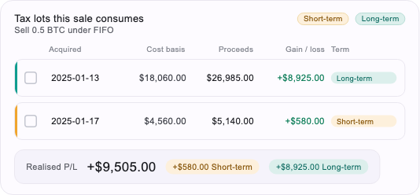
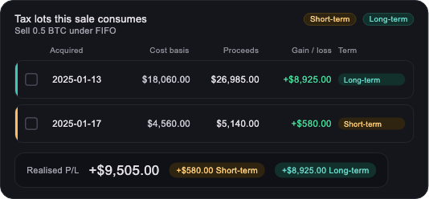
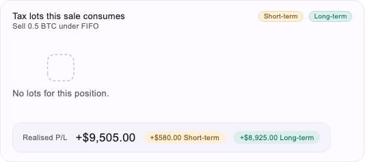

# 0003 — The tax-lot table

- **Area:** frontend
- **Status:** Implemented
- **Ticket:** [GGU-57](https://somniosoftware.atlassian.net/browse/GGU-57) — *[FE] Tax-lot table widget with short/long-term highlighting*, serving [GGU-17](https://somniosoftware.atlassian.net/browse/GGU-17) and [GGU-42](https://somniosoftware.atlassian.net/browse/GGU-42) (the design)
- **Related:** [`frontend/0001`](0001-frontend-skeleton.md) (the skeleton), [`frontend/0002`](0002-chart-primitives-and-waterfall.md) (the first design-bound component), [`client/0003`](../client/0003-client-backend-contract.md) (N-1…N-15), [ADR-L](../../docs/adr/ADR-L-client-architecture.md), [ADR-K](../../docs/adr/ADR-K-response-shaping.md), [ADR-E](../../docs/adr/ADR-E-money-representation.md)
- **Owner:** Lautaro Bertuzzi · **Date:** 2026-09-21

## 0. What it looks like

Rendered from the generated catalog example at the design's 533.37 px card
width, through the real `AppTheme`:

| | |
|---|---|
| Light |  |
| Dark |  |
| Empty |  |

**Design source, and a re-verification.** Built against the exported
`Catalog - Tax-Lot Table.html`, then re-checked against the newer fourteen-screen
project (`.design-refs/Catalog_TaxLotTable.dc.html`, 2026-09-21 12:31 UTC)
after it arrived. Every value this component encodes — all 38 colours, the
`26px 1.05fr .55fr .95fr .95fr 1fr 1.02fr` grid rule, every padding, radius and
type size, and the Zone 2 schema and Zone 3 prompt fragment — is **byte-identical
between the two**. The newer file changes nothing here.

`FlowB-Assistant.dc.html` frames the same table inside an assistant turn as a
title line (`NVDA · tax lots`) on the left with the two term pills on the
right. That is the header shape this component uses, which is corroboration for
the one substitution it makes: the catalog card's header is gallery chrome
(`DEFAULT · NVDA · 4 LOTS`), and the payload's `title`/`subtitle` take its place.

## 1. Problem

The catalog publishes six components and the client rendered two. `TaxLotTable`
is the third, and it is the one where the numbers rule is most tempting: a
table invites a client to sort its rows, total a column and work out a holding
period, and every one of those is prohibited (N-1, N-2, N-10).

It is also the first component whose **design and backend contract disagree
substantially**. GGU-42's page declares an A2UI schema
(`symbol`, `lots[].shares`, `selectedLotIds`, `realizedSummary`,
`onLotToggle(id)`) that the backend's `taxlots.table.v1` does not serve. §8
records each gap rather than inventing a field to close it.

## 2. Scope

**In**

- `app/lib/components/taxlots_table/` — the component, its model, its palette
  measured from the design, and the widgets that draw it.
- The three zone-1 states the design draws: default, and empty. (The third,
  "selected for sale", is **out** — see OD-3.)
- Light and dark, from one widget tree.

**Out**

- **Selection and the recomputed footer** (OD-3). The contract carries no
  `selectedLotIds`, its catalog entry declares `actions: []`, and the design's
  recomputed total is arithmetic this client may not do (N-2).
- **A gated golden** (§7). The decoration is asserted from the widget tree
  instead, which is a stronger check for this surface and a portable one.
- Anything under `client_flutter/`, which is a different app.

## 3. API contract (consumed, not served)

Read from `docs/catalog/view-catalog.snapshot.json`, entry `TaxLotTable` /
`taxlots.table.v1`. No new call: the component binds a payload the existing
`GET /v1/portfolios/{id}/views` already returns.

| Payload path | Drawn as |
|---|---|
| `title`, `subtitle` | the card's caption and the line under it |
| `lots[].acquired_on` | the **Acquired** column, verbatim (OD-1) |
| `lots[].cost_basis.display` | the **Cost basis** column |
| `cost_basis.label` | that column's caption — server-written, so it follows `locale` |
| `lots[].proceeds.display` | the **Proceeds** column (design: *Market value* — OD-7) |
| `proceeds.label` | that column's caption, same reason |
| `lots[].gain_loss.display` | the **Gain / loss** column (design: *Unrealized* — OD-7) |
| `lots[].term` | which colour the row's rail and pill take — `short` amber, `long` teal |
| `lots[].trend` | which colour the gain/loss takes. **Never** the sign printed in the string beside it |
| `lots[].label` | row identity. Not a figure, never rendered as one |
| `by_term[].label` | the two legend pills, and the human name of each row's term (the join, §4) |
| `by_term[].realized.display`, `by_term[].term` | the footer's two split pills |
| `realized.label`, `realized.amount.display` | the footer's caption and total |
| `lots[].units`, every `*.amount` | **read by nothing.** N-4 reserves them for chart geometry, and a table has no canvas |

`ViewPayload.geometry` — the single exemption to the numbers rule (ADR-L
D-14) — is **not called** by this component.

### Four blocks the payload carries and this card does not draw

The design has no zone for any of them, and none is a disclosure or a note.
They are listed here rather than left to be discovered, because N-9's own
detection signal is *"a payload text field present but unrendered"* and three
of the four are labelled, pre-formatted display figures:

| Path | Example value | Why not drawn |
|---|---|---|
| `price.label` + `price.amount.display` | `Price` · `$64,250.00` | sale-summary context; the artboard's card is header → columns → rows → footer, with no summary strip |
| `cost_basis.amount.display` | `$22,620.00` | the aggregate beside the per-lot column. Its **label is drawn** (above); only the total is not |
| `proceeds.amount.display` | `$32,125.00` | same |
| `remaining[].label` + `.text` (×4) | `Units left` · `0.1` … | the post-sale remainder. Note `Units left` is `"0.1"`, a raw quantity in a `text` field — drawing it would also want an N-4 ruling |

**OD-8 owns all four.** Drawing them means inventing a summary strip the
design does not have, which fails the ticket's pixel-perfect requirement;
leaving them is an N-9 reading narrower than the rule's own wording. That is a
design + contract decision, not a component-local one, so it is recorded with
an owner rather than settled here.

## 4. Data model & migration

None. No generated DTO (ADR-L D-4): the payload is read by dotted path and
lands in `TaxLotsTableData`, whose every money field is a `String`, so there is
no `double` in the model to be tempted into arithmetic with.

Two enums, `TaxLotTerm` and `TaxLotTrend`, map the contract's declared string
enums. A third spelling raises `PayloadContractException` naming the path
rather than falling back to a default (N-3).

**The term's human label is a join, not a derivation.** A row shows
`Long-term` because the `by_term` half with `term == "long"` says so — not
because a Dart map spells it. A client-authored `{'long': 'Long-term'}` would
silently ignore the `locale` option the view declares. A term with no matching
half raises.

## 5. Security notes

No new surface: no request, no credential, no storage. The component renders
server-written strings verbatim and interprets none of them — every
`ViewPayload` path in it is a string literal, which
`binding_rules_test.dart::payload paths are literals, never variables`
enforces.

## 6. Acceptance criteria

- **AC-1** The component registers `taxlots.table.v1` / `TaxLotTable` and edits no hand-written file to do it.
- **AC-2** Every figure on screen is a `*.display` string; no raw `amount` or `units` reaches a `Text`.
- **AC-3** Rows render in the order the backend sent them; nothing is sorted, filtered or totalled.
- **AC-4** The realised split comes from `by_term`, not from adding the lots up.
- **AC-5** A row's rail and pill take their colour from `term`; the gain/loss takes its colour from `trend`, never from the sign in the display string.
- **AC-6** Colours match the two artboards, measured, in both brightnesses.
- **AC-7** Layout matches the artboard's measured metrics: 48 px rows, 10 px radius, the `26px 1.05fr .95fr .95fr 1fr 1.02fr` grid, an 8 px column gap and a 7 px row gap.
- **AC-8** The empty state renders when `lots` is empty, and that is not a contract violation.
- **AC-9** A missing or undeclared field raises, naming the path.
- **AC-10** The card never overflows, at the design width or below it.
- **AC-11** `cd frontend && make gate` green.

### GGU-57's own acceptance criteria

The ticket predates ADR-L and names two things this app does not have. Mapped
honestly rather than ticked:

| Ticket AC | Status |
|---|---|
| 1 — rows bind straight from `taxlots.table.v1`; nothing displayed is computed in Dart | **met**, and the ticket's framing is this spec's AC-2/AC-3/AC-4 |
| 2 — the short/long highlight is driven by the classified field, not by date arithmetic | **met**: `lots[].term` through the `TaxLotTerm` enum. No date is ever compared; `acquired_on` is rendered and never parsed |
| 3 — long tables scroll without re-laying out the whole list; empty state renders | **half met.** The empty state renders (AC-8). The rows are a `Column`, **not** a lazy list — see OD-10 |
| 4 — widget tests bind the example payload from `docs/catalog/CONTRACT.md` | **met in spirit, different file**: tests read `docs/catalog/view-catalog.snapshot.json`, the JSON rendering of the same generated contract, which is what `.claude/rules/frontend/testing.md` §5 requires. `CONTRACT.md` is the designer's rendering of the same render pass |
| 5 — colours from `FinanceTokens` (GGU-43) | **met by the equivalent.** `FinanceTokens` does not exist in `frontend/`; GGU-43 was written for the older client. The rule it encodes — a gain/loss colour is a token, never a literal — holds: every colour is a field on `TaxLotPalette`, sourced from `TaxLotTokens`, and no widget names a `Color` |

## 7. Test plan

| AC | Test |
|---|---|
| AC-1 | `taxlots_table_component_test.dart::serves the view id the generated catalog publishes` (reads the snapshot **and** carries the literal), `::renders through the host the app really uses`; `architecture/catalog_contract_test.dart`; `architecture/component_manifest_test.dart` |
| AC-2 | `taxlots_table_card_test.dart::never puts a raw figure on screen` (six raw values asserted absent), `taxlots_table_component_test.dart::never reads the raw units, which N-4 reserves for geometry` |
| AC-3 | `taxlots_table_component_test.dart::binds every lot the backend sent, in arrival order`, `taxlots_table_footer_test.dart::keeps the halves in the order the backend sent them` |
| AC-4 | `taxlots_table_component_test.dart::takes the split straight from by_term, never adding it up` |
| AC-5 | `taxlot_row_tile_test.dart::rails a long-term lot teal`, `::rails a short-term lot amber`, `::colours a rising lot with the gain token`, `::colours a falling lot with the loss token` |
| AC-6 | `taxlot_tokens_test.dart` — 38 literal assertions across both artboards, plus `::agrees with the chart palette on every shared role` |
| AC-7 | `taxlot_row_tile_test.dart::is 48 px tall with a 10 px radius`, `taxlot_parts_test.dart::lays the design grid out after the fixed first column` |
| AC-8 | `taxlots_table_card_test.dart::shows the empty state and still shows the footer`, `taxlot_empty_test.dart` |
| AC-9 | `taxlots_table_contract_test.dart` — seven raising paths |
| AC-10 | the whole widget suite: a `RenderFlex` overflow is a test failure, and the footer's `Wrap` is what fixes it |
| AC-11 | `make gate` |

### Why no gated golden

`frontend/0002` measured that whole-card goldens drift **0.54–0.70 %** between
macOS and the Linux runner while the smallest defect worth catching moved
**1.26 %** — a signal-to-noise ratio under two — and its answer was to golden
the **chart**, which carries no text. A tax-lot card is text almost end to end;
there is no text-free region to golden, so the same reasoning that produced the
waterfall's chart-only golden produces **no** golden here.

What a golden would have claimed is claimed more precisely instead: the row's
fill, hairline, rail colour and radius are read off its `BoxDecoration`, the
cell colours off their `TextStyle`, and the text by `find.text`. A failure then
names the defect ("the rail is the wrong colour") where a golden says only that
something moved. This is `frontend/0002`'s own sentence — *the card's text is
asserted by `find.text`, which is a better check for text than a raster, and
its chrome by its constants* — applied to a surface that is all text and chrome.

### Mutation checks

| Property | Mutation | Result |
|---|---|---|
| The component is registered | `void register(ComponentRegistry)` deleted from `taxlots_table_component.dart` | `binding rules::every component module registers exactly one component` → `Expected: <1> Actual: <0>`, naming the file; `dart analyze` also red. Green again on revert |
| A figure is bound from its display string | `cost_basis.display` → `cost_basis.amount` in the binding | **4 tests red**, two naming the value: `::binds every figure from a display string` → `Expected: '$18,060.00' Actual: '18060.00'`; `::never reads the raw units, which N-4 reserves for geometry` → `Expected: not contains '18060.00'`. Green again on revert |

## 8. Open decisions

The design's A2UI schema and the backend's `taxlots.table.v1` are different
surfaces. Each row is a field the design asks for that the contract does not
carry; **none of them was invented on the client.**

| # | Question | Owner | Default if unresolved |
|---|---|---|---|
| OD-1 | The design shows `Mar 12, 2021`; the payload carries `acquired_on: "2025-01-13"` and no display form. Re-spelling a date is formatting, and `package:intl` is one of the twelve mechanisms `binding_rules_test.dart` fails on. Add `lots[].acquired_on_display`? | backend + design | the ISO date renders verbatim |
| OD-2 | The design has a **Shares** column. The contract's only per-lot quantity is `units` (`"0.42"`), which N-4 names explicitly as a raw figure that must never reach a user. Add `lots[].units_display`? | backend | the column is not drawn |
| OD-3 | The design's second zone-1 state is **selected for sale with the footer recomputed**. The contract has no `selectedLotIds`, its catalog entry declares `actions: []`, and recomputing a total client-side is N-2. Closing it needs three things: the field, a declared action (spec `backend/0022`), and a per-selection `realizedSummary` from `simulate_sale`. A fourth, smaller gap sits under it: `lots[].fully_sold` **is** in the payload and is the nearest signal, but `ViewPayload` exposes no boolean accessor, and adding one is a change to the shared binding surface that this ticket deliberately did not make. | backend + design + FE | the tick box renders in its unchecked (design-default) state and nothing is selectable |
| OD-4 | The design colours the footer total green. `realized` carries no `direction`/`trend`, unlike every lot. The two ways to recover one — parsing the `+` off the display string, or taking the sign through `ViewPayload.geometry` — are N-1 and a use ADR-L D-14 reserves for canvas coordinates. Add `realized.direction`? | backend | the total renders in the neutral title colour |
| OD-5 | The design abbreviates the split pills to `$4,100 LT`. The contract's short name for a half is its `label` (`Long-term`), so the pill reads `+$8,925.00 Long-term`. Coining `LT` in Dart is client-authored copy that ignores `locale`. Add `by_term[].short_label`? | backend + design | the pill carries the full label |
| OD-6 | The design sets Inter for labels and Roboto Mono for figures; the app bundles no font. `frontend/0002` OD-4 settled this for the waterfall — `tabularFigures` on the bundled face — and this follows it. | design | keep `tabularFigures` |
| OD-7 | Two column captions are renamed to the field they show: **Proceeds** where the design says *Market value*, **Gain / loss** where it says *Unrealized*. These are lots the sale **consumes**, so the figure beside them is realised, not unrealised, and the backend's own `proceeds.label` is `Proceeds`. Keep the honest caption or match the artboard? | design | the honest caption |
| OD-8 | **Four payload blocks are present and undrawn** — `price`, the `cost_basis` and `proceeds` *totals*, and `remaining[]` (§3 tabulates them). The design's card has no summary strip, so drawing them means inventing layout; leaving them reads N-9 more narrowly than its own wording (*"server-written `label`/`text` are rendered verbatim"*, signal: *"a payload text field present but unrendered"*). Extend the design with a summary strip, trim the projection, or amend N-9 to scope it to disclosures and notes? `remaining[]` additionally carries `Units left: "0.1"` — a raw quantity in a `text` field, which wants an N-4 ruling of its own. **Raised by review, not settled on the branch.** | design + the `client/0003` owner | not drawn; the two labels that name a rendered column *are* drawn |
| OD-9 | `tool/coverage_sources.dart::hasExecutableCode` treats any non-comment, non-import line as executable, so a file of only `static const` declarations is required to have an lcov record that lcov will never write. It was written for `export` barrels and does not know about const-only files. This component worked around it rather than editing the gate (§9). | FE | the workaround stands |
| OD-10 | GGU-57 AC-3 asks that **long tables scroll without re-laying out the whole list**. The rows are a `Column`: the card is a fixed-height block inside whatever scrolls it, and `lots[]` is bounded by the sale — the `quantity` option decides how many lots it consumes, and the published example has two. Making it lazy inside an outer scroll needs slivers and would change the card from a widget into a scrollable, while a `shrinkWrap: true` `ListView` is strictly worse than the `Column` it would replace (it builds every child anyway and adds a scroll context). Deferred until a payload actually arrives with enough lots to matter — at which point the right fix is probably a cap plus a "show all" action, not laziness. | FE + backend (is `lots[]` bounded?) | a `Column`, and the question asked |

## 9. Rollout & observability

No flag, no migration, no new request. The component appears on the portfolio
surface automatically: the route names no view ids (GGU-79), so registering it
is what puts it on screen, and `app_router_test.dart::every registered
component is reachable from the route` holds that.

**One gate limitation was worked around, not edited** (OD-9). Three files in
this component would have been const-only — the measured metrics, the type
scale and the two enums — and `check_coverage` fails a const-only file for
having no lcov record. Rather than add an exemption to shared tooling, each
file was given the behaviour its call sites already wanted:

- `TaxLotType`'s roles became **functions of their colour**, because every use
  was `style.copyWith(color: …)`; that removed the `copyWith` from eleven call
  sites.
- `TaxLotMetrics` grew `BorderRadius` getters, because every radius was used as
  one; that removed `BorderRadius.circular(…)` from six.
- `TaxLotTerm` gained `colorsIn(palette)`, moving the term→colour lookup off a
  static on the row widget and onto the term itself — the legend and the footer
  ask the same question and neither is a row.

All three are better than what they replaced, which is why this is recorded as
a workaround rather than a compromise. The underlying gate defect is OD-9 and
is worth a ticket of its own: the next const-only file will hit it again.
